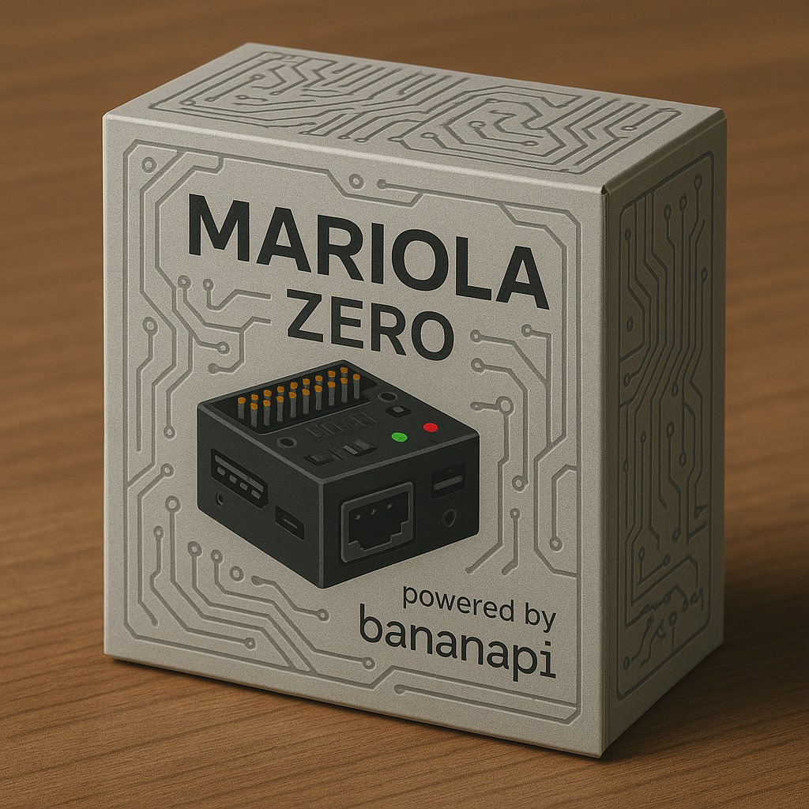

# MariolaZero

Brick de robótica **Mariola**: um Banana Pi M4 Zero (Linux Armbian) com uma placa própria
(ATmega328PB) para motores com encoder, servos, LEDs e uma fileira de conectores para sensores.
Usado pelas equipes Titãs da Robótica (Ifes Colatina) na RoboCupJunior Rescue Line e Rescue Maze.

## O que tem aqui

| Pasta / arquivo | O que é |
|---|---|
| [`INSTALACAO.md`](INSTALACAO.md) | como instalar e configurar o Linux do brick (Armbian, kernel, Python, rede, serviços, recuperação) |
| [`instalacao/`](instalacao/) | arquivos de apoio da instalação (cooler, regra das câmeras, overlays, `remonta.sh`) |
| [`documentação/`](documentação/) | manual das bibliotecas e dos [conectores](documentação/Conectores.md) |
| [`firmware/mariola/`](firmware/mariola/) | firmware da placa do Mariola (`.hex`) e [como regravar](firmware/mariola/LEIAME.md) num brick |
| [`libs/`](libs/) | bibliotecas Python do Mariola (rodam no robô) |
| [`exemplos/`](exemplos/) | programas de exemplo de cada biblioteca |
| [`menuPrincipal/`](menuPrincipal/) | o menu da tela e do teclado, que inicia os programas no robô |
| [`curso/`](curso/) | curso para os alunos: site em https://juliovendramini.github.io/MariolaZero/curso/ |
| [`simuladorLine/`](simuladorLine/), [`simuladorMaze/`](simuladorMaze/) | simuladores da Rescue Line e da Rescue Maze que rodam os programas do robô sem alteração |
| [`telemetria/`](telemetria/) | telemetria pela rede |

## Por onde começar

* **Montar um brick novo:** [`INSTALACAO.md`](INSTALACAO.md).
* **Programar o robô:** o [curso](https://juliovendramini.github.io/MariolaZero/curso/), a partir
  do módulo 1.
* **Testar sem o robô:** os simuladores (`simuladorLine/README.md`, `simuladorMaze/README.md`).
