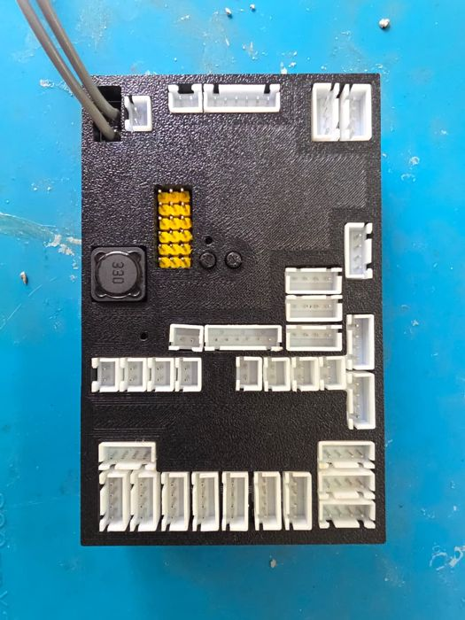
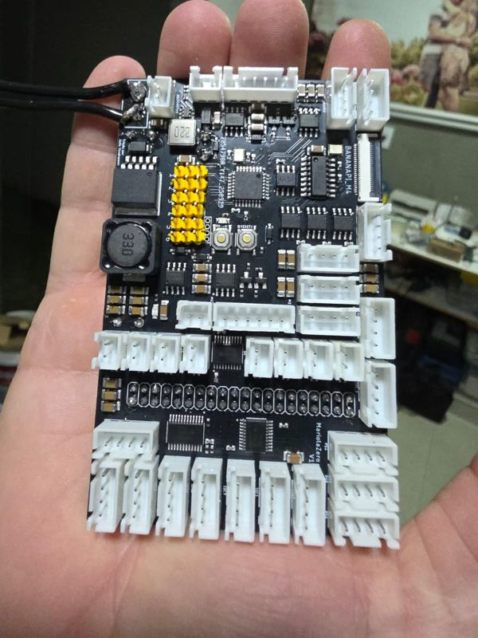
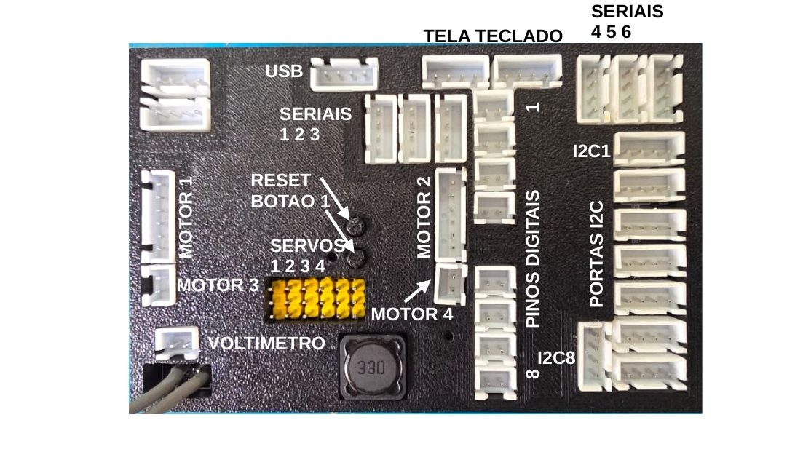
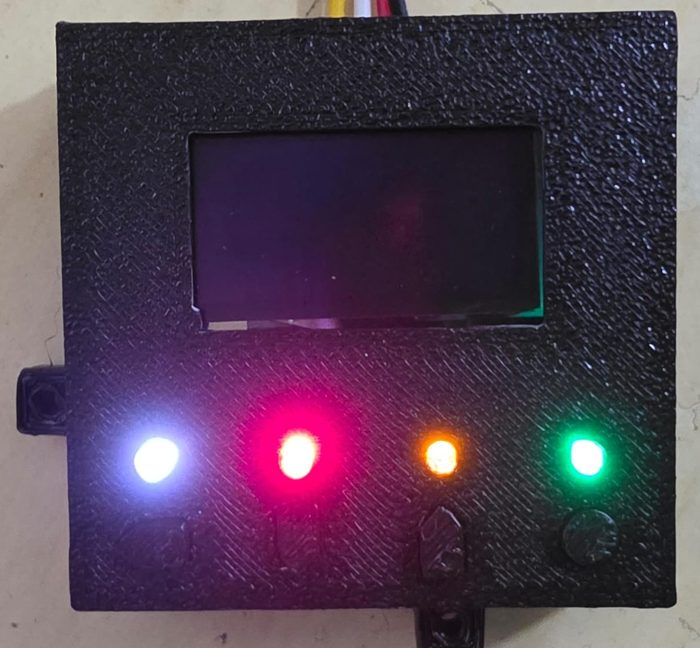

# Módulo 1 — Conhecendo o brick Mariola

**Objetivo:** saber o que tem dentro do brick, o que se liga em cada conector e como o seu
programa em Python chega até um motor ou um sensor.



## 1.1 Dois computadores numa caixa

O Mariola tem **dois processadores** que trabalham juntos:

| | Banana Pi M4 Zero | Placa do Mariola (ATmega328PB) |
|---|---|---|
| O que é | um computador Linux (Armbian), 4 núcleos, Wi-Fi | um microcontrolador, como um Arduino |
| Roda | **o seu programa em Python**, a câmera, a IA | PWM dos motores, PID, encoders, servos, LEDs |
| Por quê | tem força para visão, mapas, estratégia | responde em tempo real, sem "engasgos" do Linux |

O Banana Pi manda ordens ("motor 1 a 40") e a plaquinha executa e responde ("o encoder está em
1234"). Os dois conversam por uma **serial interna**. Isso explica várias regras do curso: por
exemplo, se o Python travar, a plaquinha percebe que ficou **5 s sem ordens** e desliga os motores.



## 1.2 Os conectores



| Conector | Quantos | Pinos | Para quê |
|---|---|---|---|
| **MOTOR 1, MOTOR 2** | 2 | PWM1, PWM2, GND, 5V, ENCODER_DIR, ENCODER_CLK | motores **com encoder** |
| **MOTOR 3, MOTOR 4** | 2 | 2 fios | motores **sem encoder** |
| **SERVOS 1–4** | 4 | SINAL, 5V, GND | servos comuns de hobby |
| **SERIAIS 1, 2, 3** | 3 | TX, RX, GND, 5V | placas e sensores seriais (conversores USB dentro do brick) |
| **SERIAIS 4, 5, 6** | 3 | TX, RX, GND, 5V | placas e sensores seriais (UART do Banana Pi) |
| **I2C1 … I2C8** | 8 | SDA, SCL, GND, 5V | sensores I2C, um por conector (passam por um multiplexador) |
| **PINOS DIGITAIS 1–8** | 8 | GND, PINO | botões, chaves, LEDs; entrada ou saída, aceitam 5 V, com proteção |
| **TELA**, **TECLADO** | 2 | SDA, SCL, GND, 3,3V | a placa da tela + teclado vai no TELA; o TECLADO é da placa antiga (**sem proteção!**) |
| **USB** | 1 | GND, DP, DM, 5V | câmera, pendrive, adaptador Wi-Fi |
| **VOLTÍMETRO** | 1 | GND, VBAT+ | mede a bateria |
| **RESET**, **BOTÃO 1** | 2 botões na placa | | |

O arquivo `documentação/Conectores.pdf` tem a foto de cada conector com a pinagem.

### A placa da tela e do teclado



Uma placa só, no conector **TELA** (barramento I2C 0): a **tela OLED 128×64** e, embaixo dela,
**4 LEDs** (branco, vermelho, laranja, verde) e **4 botões** (Voltar, Baixo, Cima, Enter, da
esquerda para a direita). O menu principal usa a placa para escolher e iniciar os programas; o seu
programa pode usá-la para menus, calibração e para mostrar o estado do robô (módulo 8).

## 1.3 O que costuma ser ligado onde

Os robôs do curso (e dos simuladores) usam esta montagem. Não é obrigatória, mas seguir um padrão
na equipe evita confusão:

| Onde | Robô 4x4 da Line | Robô de esteira da Line | Robô da Maze |
|---|---|---|---|
| MOTOR 1 / 2 | rodas traseiras esq./dir. | esteiras esq./dir. | rodas traseiras |
| SERIAL1 | **barramento**: 2 placas de motor (rodas da frente, IDs 8 e 51) + 4 servos inteligentes da garra (IDs 70–73) | — | 2 placas de motor |
| SERIAL5 | giroscópio | giroscópio | giroscópio |
| SERIAL6 | sensor de linha Pro1616 | sensor de linha Pro1616 | Pro1616 (cor do piso) |
| I2C1 / I2C3 / I2C5 | VL53 esquerda / direita / frente | VL53 esquerda / direita / frente | VL53 laterais da frente / frente |
| I2C2 | VL53 da garra | — | VL53 esquerdo de trás |
| I2C4 | — | — | VL53 direito de trás |
| I2C6 / I2C7 | TCS34725 horizontal frente / trás | — | — |
| P1 / P2 | para-choque esq./dir. | para-choque | para-choque |
| P3 | botão de início | botão de início | botão de início |
| USB | câmera da frente | — | câmeras laterais |

## 1.4 As placas e sensores externos

| Peça | O que faz | Biblioteca |
|---|---|---|
| **Sensor de linha Pro1616** (foto no módulo 6) | 12 sensores IR (em 4 canais) + 3 sensores de cor TCS34725 | [`sensorCorReflexao`](referencia/sensorCorReflexao.md) |
| **Placa do giroscópio** | ângulos X, Y, Z prontos | [`giroscopio`](referencia/giroscopio.md) |
| **Placa de controle de motor** | 1 motor com encoder, PID, num barramento com ID | [`placaControleMotor`](referencia/placaControleMotor.md) |
| **Servo inteligente** (MG90S + placa) | servo que informa a posição e detecta trava, com ID | [`placaControleServo`](referencia/placaControleServo.md) |
| **VL53L0X** | distância a laser | [`vl53`](referencia/vl53.md) |
| **TCS34725** | cor | [`tcs34725`](referencia/tcs34725.md) |
| **BNO085** | IMU 9 eixos com fusão | [`bno085`](referencia/bno085.md) |
| **Câmera USB** | vítimas, triângulos | [`visao`](referencia/modulos-simulador.md) + `exemplos/camera` |

## 1.5 O caminho de um comando

```
 main.py:   motores.velocidade_motores(40, 40)
              │
 motores.py:  monta um pacote de 10 bytes  [0xFC, 40, 40, 0, 0, ...]
              │  pyserial
 Linux:       /dev/ttyUSB... (serial interna, 250000 baud)
              │
 ATmega328PB: PID → PWM → ponte H → motor      e responde: [0xFC, encoder1, encoder2, estado]
```

Todo sensor e atuador funciona assim: uma **biblioteca Python** que fala um **protocolo** com uma
**placa**. Você usa só a biblioteca. Saber que existe um pacote indo e voltando ajuda a entender
por que algumas leituras "demoram" (I2C, VL53) e outras não (sensores com thread).

**Isso também é o que torna o simulador possível:** ele troca só a parte de baixo (a serial, o
I2C, os pinos) por placas virtuais que respondem os mesmos bytes. As bibliotecas e o seu programa
são **exatamente os mesmos** no robô e no simulador.

## 1.6 Cuidados com o hardware

* Bateria: confira a tensão antes de treinar e de cada rodada. Bateria fraca muda tudo (velocidade
  máxima, leitura dos sensores IR).
* Nunca ligue nada nos conectores TELA/TECLADO além da tela e do teclado.
* Desligue o robô antes de ligar ou tirar cabos.
* Ao desligar, use o menu (Desligar Brick) ou `sudo shutdown -h now`: cortar a energia com o Linux
  gravando pode estragar o cartão (o README do brick explica como deixar a partição principal
  somente leitura para evitar isso).

## Exercícios

1. Desenhe (em papel) o seu robô visto de cima e anote o conector de cada peça.
2. Por que os motores 3 e 4 não aceitam `move_motor` (giro por ângulo)?
3. Você tem dois VL53L0X iguais (mesmo endereço I2C). Por que dá para usar os dois ao mesmo tempo
   no Mariola?
