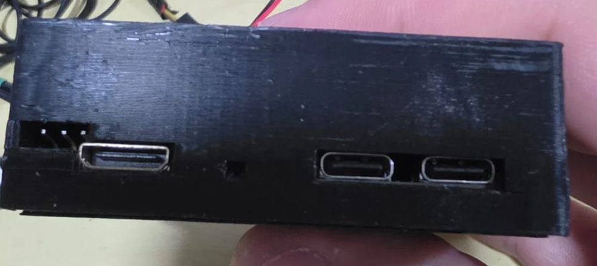
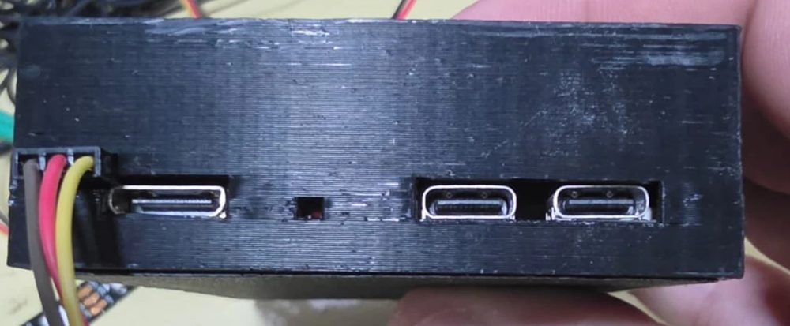

# Módulo 2 — Preparando o computador, mandando e rodando programas

**Objetivo:** ter tudo instalado no computador, saber mandar um programa para o robô, rodá-lo pelo
menu ou pelo terminal e ver o que ele imprimiu.

## 2.1 No seu computador

1. **Python 3.11 ou mais novo** (python.org; no Windows marque "Add Python to PATH"). Versões
   antigas no Windows deixam o simulador lento.
2. **VS Code** com a extensão Python.
3. As bibliotecas dos simuladores (o Pillow é o que desenha a tela OLED, como no robô):
   ```bash
   pip install pygame pymunk numpy pillow
   ```
4. As pastas do projeto do brick (`bananaPiM4Zero/`): `libs/`, `exemplos/`, `simuladorLine/`,
   `simuladorMaze/`, `curso/` (este curso).

Teste o simulador:
```bash
cd simuladorLine
python simulador.py
```
Clique em **▶ Iniciar rodada**: o robô de exemplo começa a seguir a linha. (O
[módulo 11](11-simulador-line.md) explica a janela toda.)

## 2.2 A pasta de um projeto

Cada programa do robô é **uma pasta** com um `main.py`. A pasta precisa ter **as bibliotecas que o
programa usa** (por enquanto o robô não tem as libs instaladas no sistema):

```
meuSeguidor/
├── main.py                 ← o programa (é ele que o menu roda)
├── robo.py                 ← seus módulos (opcional)
├── motores.py              ← cópias das libs usadas (de bananaPiM4Zero/libs/)
├── portas.py
├── sensorCorReflexao.py    ← a V2! (exemplos/11-sensorCorReflexaoV2/)
├── giroscopio.py
├── simdebug.py             ← de simuladorLine/robo_real/ (no robô não faz nada)
├── envia.bat  ou envia.ps1 ← manda a pasta para o robô (no Linux: envia.sh)
└── executa.sh              ← (opcional) roda pelo terminal
```

* Copie **todas** as libs que o programa importa — e as que elas importam (quase todas usam
  `portas.py`).
* No simulador você pode rodar o mesmo `main.py`: ele usa as libs da pasta do programa e, se faltar
  alguma, a cópia `libs_mariola/` dele.

## 2.3 Conectando no robô

### Pela rede (SSH), quando o robô tem IP

1. Ligue o robô e espere o menu aparecer na tela. A **primeira linha mostra o IP** e a temperatura
   da CPU (ex.: `192.168.2.151 48°C`).
2. O computador precisa estar na **mesma rede** (mesmo Wi-Fi).
3. Teste no terminal (PowerShell ou Linux):
   ```bash
   ssh banana@192.168.2.151
   ```
4. Para não digitar senha toda vez, configure a **chave SSH** (logo abaixo).

Usuário: `banana`. Os projetos ficam em `/home/banana/<nome-da-pasta>/`.

### Sem senha: a chave SSH

Sem a chave, o `ssh`, o `scp` e o `envia.bat` pedem a senha do robô toda vez. Com ela, entram
direto. A chave tem duas partes:
* a **privada**, que fica só no seu computador e não é para mandar para ninguém;
* a **pública** (`.pub`), que você copia para o robô. O robô deixa entrar quem tem a privada que
  combina com ela.

**1. Gere a chave no computador** (uma vez só, vale para todos os robôs). No PowerShell (Windows)
ou no terminal (Linux), é o mesmo comando:

```bash
ssh-keygen -t ed25519
```

Aperte **Enter** em todas as perguntas: lugar padrão e sem senha na chave. Se ele perguntar
`Overwrite (y/n)?`, é porque você já tem uma chave: responda **n** e siga para o passo 2 com ela.
A chave pública fica em `~/.ssh/id_ed25519.pub`, que no Windows é
`C:\Users\<você>\.ssh\id_ed25519.pub`.

**2. Copie a chave pública para o robô** (uma vez para cada robô). Troque o IP pelo do seu robô. Ele
vai pedir a senha do robô **pela última vez**.

* **Windows** (PowerShell), tudo numa linha:
  ```powershell
  type $env:USERPROFILE\.ssh\id_ed25519.pub | ssh banana@192.168.2.151 "mkdir -p ~/.ssh && tr -d '\r\357\273\277' >> ~/.ssh/authorized_keys && chmod 700 ~/.ssh && chmod 600 ~/.ssh/authorized_keys"
  ```
  Esse comando manda a chave pelo próprio `ssh` e acrescenta no fim do arquivo `authorized_keys`
  do robô. O `tr -d` tira o que o PowerShell acrescenta no caminho e que estragaria a linha: a
  quebra de linha do Windows (`\r`) e, em alguns PCs, 3 bytes invisíveis no começo (o "BOM").
* **Linux:**
  ```bash
  ssh-copy-id banana@192.168.2.151
  ```

Se a sua chave é a antiga (`id_rsa.pub`), troque o nome no comando do Windows; o `ssh-copy-id`
acha sozinho.

**3. Teste:**

```bash
ssh banana@192.168.2.151
```

Tem de entrar **sem pedir senha**. A partir daqui o `envia.bat` (item 2.4) também não pede mais.

**Se ainda pedir senha:**
* Confira se você copiou para o usuário `banana` (e não `root`) e para o IP certo.
* No robô, as permissões têm de ser estas (o SSH ignora a chave se a pasta estiver aberta demais):
  ```bash
  chmod 700 ~/.ssh
  chmod 600 ~/.ssh/authorized_keys
  ls -la ~/.ssh
  ```
* Veja se a linha da sua chave está lá: `cat ~/.ssh/authorized_keys`. Cada chave é **uma linha**,
  começando com `ssh-ed25519` ou `ssh-rsa`.

**Robô regravado ou trocado:**
* Quem regrava a eMMC do robô pela imagem (`INSTALACAO.md`, seção 17) apaga as chaves que tinham
  sido copiadas depois: faça o passo 2 de novo.
* Se o PC avisar `REMOTE HOST IDENTIFICATION HAS CHANGED`, é porque o IP agora é de outro robô (ou
  do mesmo, regravado). Apague o registro antigo e conecte de novo:
  ```bash
  ssh-keygen -R 192.168.2.151
  ```

### Sem IP: pela porta de debug (serial)

Se a tela não mostra IP (o robô não está em nenhuma rede, o Wi-Fi é outro, o menu não subiu), o
SSH não funciona. Aí o caminho é o **terminal serial** do Banana Pi, pela **porta de debug** do
brick. Ela funciona mesmo sem rede e mostra até as mensagens do boot.

**O que precisa:** um conversor **USB-serial** (TTL de **3,3 V**, como os de CH340, CP2102 ou FTDI)
e três fios.

A porta de debug são os **3 pinos no canto da lateral** do brick, ao lado da mini HDMI. O pino
mais externo (na borda da caixa) é o **GND**. (Não é a coluna DEBUG/PWM do header amarelo: aquela é
do ATmega, não dá acesso ao Linux.)





1. Com o robô **desligado**, ligue o conversor na **porta de debug**:

   | Conversor | Porta de debug do brick |
   |---|---|
   | **GND** | **GND: o pino mais externo da placa** |
   | **RX** | TX da placa |
   | **TX** | RX da placa |

   * O TX de um vai no RX do outro (é cruzado).
   * **Não ligue o VCC/5V do conversor**: o brick tem a própria alimentação.
2. Ligue o conversor no PC e descubra a porta: no Windows, **Gerenciador de Dispositivos → Portas
   (COM e LPT)** (ex.: `COM5`); no Linux, `/dev/ttyUSB0`.
3. Abra um terminal serial a **115200 bps** (8N1, sem controle de fluxo):
   * Windows: **PuTTY** (Connection type: *Serial*, Serial line `COM5`, Speed `115200`). O
     `putty.exe` roda sem instalar.
   * Linux: `screen /dev/ttyUSB0 115200` (sai com `Ctrl+A` e depois `K`).
4. Ligue o robô. As mensagens do boot aparecem; no fim, aperte **Enter** para ver o `login:`.
   Entre com o usuário `banana` e a senha do robô.
   * **Não apareceu nada?** Confira o GND e **troque o TX com o RX**: é o erro mais comum.
   * Apareceram caracteres estranhos? A velocidade não está em 115200.
5. Já dentro do robô:
   * `hostname -I` mostra o IP (se ele tiver um). Com o IP, volte a usar o SSH, que é mais
     confortável.
   * Para ligar o Wi-Fi: libere a partição do sistema (`sudo mount -o remount,rw /`,
     veja o item 2.6) e use `sudo armbian-config` → Network.

O terminal serial é bom para consertar o robô, não para trabalhar: para mandar programas, use a
rede (2.4).

## 2.4 Mandando o programa

### Com o `envia.bat` (simples)
Copie `exemplos/01-olamundo/envia.bat` para a pasta do projeto e **troque o IP** na linha
`set IP=...`. Rodando ele (duplo clique ou `.\envia.bat` no terminal do VS Code):

1. copia **tudo** da pasta para `~/<nome-da-pasta>` no robô (`scp -r`);
2. encerra o `main.py` que estiver rodando (`killall main.py`).

O nome da pasta no robô é o mesmo da pasta no PC.

### Com o `envia.ps1` (mais rápido)
`exemplos/10-expansaoMotor/envia.ps1` manda **só os arquivos que mudaram** desde o último envio
(guarda as datas no arquivo `.manifest`), empacotando vários num `.tar.gz`. Troque o `$IP` no
começo. Rode com:
```powershell
powershell -ExecutionPolicy Bypass -File envia.ps1
```
* Na **primeira vez**, crie a pasta no robô: `ssh banana@IP "mkdir -p ~/meuSeguidor"`.
* Ele manda só os arquivos da pasta (não as subpastas).
* No fim ele encerra **qualquer** `python3` rodando no robô.

### No Linux (ou macOS): `envia.sh`
Todo exemplo tem um `envia.sh`. Copie para a pasta do projeto e **troque o IP** na linha `IP=...`
(ou passe o IP na hora). No terminal:
```bash
bash envia.sh                  # manda só o que mudou desde o último envio
bash envia.sh --tudo           # manda a pasta inteira
bash envia.sh 192.168.2.151    # outro robô, sem mexer no arquivo
```
* Manda a pasta com as subpastas (menos `__pycache__`) para `~/<nome-da-pasta>` e cria a pasta
  no robô se ela ainda não existir.
* Guarda a data do envio num arquivo `.ultimo_envio_<IP>` na pasta: da próxima vez, só vai o que
  foi salvo depois. Passadas 3 horas, ou para um IP novo, ele manda tudo de novo.
* No fim encerra o `main.py` que estiver rodando no robô (como o `envia.bat`).
* Precisa só do `ssh` e do `tar`, que já vêm no Linux. Sem a chave SSH, pede a senha uma vez.
* Para rodar com `./envia.sh` em vez de `bash envia.sh`: `chmod +x envia.sh` uma vez.

### Pelo VS Code (F5 ou Ctrl+Shift+B)
Abra **a pasta do projeto** no VS Code (Arquivo → Abrir Pasta), não a pasta de cima. A pasta
`.vscode/` dos exemplos já tem os dois atalhos; copie-a junto para o seu projeto.

* **Ctrl+Shift+B** roda o envio certo para o sistema: `envia.bat` no Windows, `envia.sh` no Linux
  e no macOS (o `.vscode/tasks.json`). Não precisa escolher nada.
* **F5** roda a configuração escolhida no painel **Executar e Depurar** (Ctrl+Shift+D). O
  `.vscode/launch.json` tem duas: **Executar envia.bat** (Windows) e **Enviar para o robô
  (Linux/macOS: envia.sh)**. No Linux, escolha a segunda na lista do topo do painel **uma vez**; o
  VS Code lembra e o F5 passa a usar ela. Ela roda o `bash envia.sh` no terminal do VS Code e não
  precisa de extensão.

## 2.5 Rodando o programa

### Pelo menu (como na competição)
O **menu principal** (`menuPrincipal/`, iniciado como serviço no boot) lista as pastas de
`/home/banana` que têm `main.py`:

| Tecla | Faz |
|---|---|
| ↑ / ↓ (CIMA / BAIXO) | escolhe o programa |
| ENTER | roda o programa escolhido |
| VOLTAR | volta para a lista |
| VOLTAR segurado 2 s | menu Desligar / Reiniciar / Wi-Fi off / Wi-Fi on / Desbloquear / Iniciar X |

* Se a pasta tiver um **`main.sh`**, o menu roda ele em vez do `main.py` (útil para passar opções
  ao Python).
* O programa roda **sem terminal**: o que ele imprime vai para **`/home/banana/logs/NNNNNN.log`**
  e os erros para **`NNNNNN_erro.log`** (um número novo a cada execução).
* Enquanto o seu programa roda, o menu espera. Quando ele termina, o menu volta.

> **Dois cuidados quando o programa é iniciado pelo menu:**
>
> 1. **A pasta atual é `/home/banana`, não a do projeto.** Um arquivo aberto com nome simples
>    (`open('cores.json')`) vai parar em `/home/banana/cores.json`. Monte o caminho a partir do
>    próprio programa:
>    ```python
>    import os
>    PASTA = os.path.dirname(os.path.abspath(__file__))
>    ARQUIVO_CORES = os.path.join(PASTA, 'cores.json')
>    ```
> 2. **A saída vai para um arquivo e o Python a guarda em blocos** (só grava de tempos em tempos).
>    Para o log sair na hora, ponha no começo do `main.py`:
>    ```python
>    import sys
>    sys.stdout.reconfigure(line_buffering=True)
>    ```
>    ou crie um `main.sh` com `python3 -u /home/banana/meuSeguidor/main.py`.

Para ver o log de outro computador enquanto o robô roda:
```bash
ssh banana@IP "tail -f \$(ls -t ~/logs/*.log | head -1)"
```

### Pelo terminal (para testar)
```bash
ssh banana@IP
cd ~/meuSeguidor
python3 -u main.py
```
(O `executa.sh` dos exemplos faz isso.) `Ctrl+C` interrompe o programa: o Python gera um
`KeyboardInterrupt`, e o seu `try/finally` para os motores (veja o [módulo 3](03-primeiro-programa.md)).

O `.bashrc` do robô já ativa o ambiente Python (`meu_venv`). Se instalar algo com `pip`, ative
antes: `source ~/meu_venv/bin/activate`.

## 2.6 A partição somente leitura

Para o cartão SD não corromper quando a bateria é tirada com o robô ligado, a **partição do
sistema** pode estar montada **somente leitura**. A pasta `/home/banana` fica em outra partição e
continua gravável: seus projetos, logs e arquivos de calibração funcionam normalmente.

Para instalar pacotes (`apt`, `pip` no sistema), libere antes: menu → **Desbloquear** (ou
`sudo mount -o remount,rw /`). Reiniciando, volta a ser somente leitura.

## 2.7 Outras formas de mexer nos arquivos do robô

* **Samba:** o brick pode compartilhar a pasta do usuário na rede (abre no Windows Explorer como
  `\\IP\home`). Configuração no `INSTALACAO.md` do brick, seção 15.
* **VS Code Remote-SSH:** abre a pasta do robô direto no VS Code (bom para ajustes rápidos no
  campo; lembre de trazer as mudanças de volta para o PC).

## Checklist

- [ ] O simulador abre e o exemplo roda.
- [ ] `ssh banana@IP` entra sem senha.
- [ ] O `envia` manda a pasta e o projeto aparece no menu do robô.
- [ ] Você achou o log da última execução em `~/logs/`.

## Exercício

Mande o projeto `codigos/01_ola_mariola/` (copie as libs `motores.py` e `portas.py` para dentro
dele), rode pelo menu e encontre a saída dele no log.
