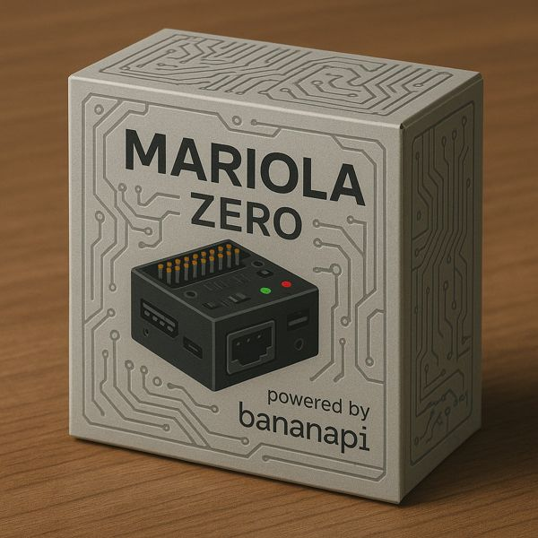

# Curso: robôs de resgate com o brick Mariola

Do primeiro motor girando até a prova completa da **RoboCupJunior Rescue Line** (com a área de
resgate) e da **Rescue Maze**, usando as bibliotecas do Mariola e os simuladores.



## Para quem é

Para alunos que já sabem o básico de Python (variáveis, `if`, `while`, funções, listas e
dicionários). Não precisa saber eletrônica: o que for preciso do hardware está no módulo 1.

## Como usar

* Siga os módulos **em ordem**: cada um usa o que veio antes.
* Cada tutorial tem um **programa pronto e testado** em [`codigos/`](codigos/). Rode, leia, mude.
* Teste **primeiro no simulador**, depois no robô.
* A [**referência das bibliotecas**](referencia/README.md) explica todos os métodos, quando usar
  cada um e os cuidados. Consulte sempre.
* Os exercícios no fim de cada módulo são o que fixa o conteúdo. Os
  [desafios](18-desafios.md) juntam vários módulos e são conferidos pelo computador (`avalia.py`).

## Módulos

### Parte 1 — Começando
| | Módulo | Você vai aprender |
|---|---|---|
| 1 | [Conhecendo o brick Mariola](01-o-brick-mariola.md) | o que tem dentro, os conectores, o caminho de um comando |
| 2 | [Ambiente, envio e execução](02-ambiente-e-envio.md) | instalar, mandar o programa, rodar pelo menu, ver os logs |
| 3 | [O primeiro programa](03-primeiro-programa.md) | a estrutura de todo programa, `try/finally`, as regras de ouro |

### Parte 2 — Atuadores e sensores
| | Módulo | Você vai aprender |
|---|---|---|
| 4 | [Motores e encoders](04-motores-e-encoders.md) | velocidade × potência, andar distâncias, 4x4 com placas de motor |
| 5 | [Giroscópio](05-giroscopio.md) | girar certo, andar reto, rampas; o controle proporcional |
| 6 | [Sensor de linha](06-sensor-de-linha.md) | ler e calibrar o Pro1616, seguidores liga-desliga, P e PD, cores |
| 7 | [Sensores de distância](07-sensores-de-distancia.md) | VL53L0X: vários sensores, parar na parede, seguir parede |
| 8 | [Botões, tela, teclado e tempo](08-botoes-tela-teclado.md) | botão de início, para-choque, menu no robô, cronômetro |
| 9 | [Servos inteligentes](09-servos-inteligentes.md) | IDs, calibração de posições, garra e caçamba sem derrubar a vítima |
| 10 | [Câmera e visão](10-camera-e-visao.md) | achar vítimas e triângulos; do stub à câmera real |

### Parte 3 — Simuladores e organização
| | Módulo | Você vai aprender |
|---|---|---|
| 11 | [Simulador da Line](11-simulador-line.md) | janela, editor, juiz, semente, testes sem janela |
| 12 | [Simulador da Maze](12-simulador-maze.md) | câmeras, LEDs de vítima, kits, mapas |
| 13 | [Organizando o código](13-organizando-o-codigo.md) | camada de hardware, máquina de estados, depuração |

### Parte 4 — Projetos
| | Módulo | Você vai aprender |
|---|---|---|
| 14 | [Projeto Rescue Line](14-projeto-rescue-line.md) | verde, curvas de 90°, gap, obstáculo, rampa, chegada |
| 15 | [Projeto área de resgate](15-projeto-area-de-resgate.md) | entrar, recolher, depositar nos triângulos, sair |
| 16 | [Projeto Rescue Maze](16-projeto-rescue-maze.md) | mão direita, mapa interno, BFS, checkpoint |
| 17 | [Do simulador para o robô](17-do-simulador-para-o-robo.md) | medir o robô, calibrar, checklist de competição |
| 18 | [Desafios e projetos](18-desafios.md) | trilha de desafios com correção automática (`avalia.py`), pista e labirinto surpresa, projeto final, avaliação, cronograma |

## O que tem nesta pasta

```
curso/
├── README.md                ← você está aqui
├── 01-...md a 18-...md      ← os módulos
├── referencia/              ← documentação de cada biblioteca (todos os métodos)
├── codigos/                 ← os programas dos tutoriais (testados no simulador)
│   ├── 01_ola_mariola/      02_motores/      03_giroscopio/    04_linha/
│   ├── 05_distancia/        06_interface/    07_servos/        08_camera/
│   └── 09_maze/
├── mapas/                   ← mapas do curso (também em simuladorLine/mapas/)
│   ├── curso_pista.json     (só retas e curvas: para treinar o PID)
│   └── curso_area.json      (o robô começa na frente da área de resgate)
└── imagens/
```

## Rodando os códigos do curso

De dentro da pasta do simulador (`simuladorLine` ou `simuladorMaze`), aponte para o programa:

```bash
cd simuladorLine
python simulador.py --robo robo_esteira.json --programa ../curso/codigos/01_ola_mariola/main.py
```

Cada programa diz, no comentário do começo, **qual simulador, robô e mapa** usar. Para rodá-los no
robô real, copie as bibliotecas que eles importam para dentro da pasta (módulo 2).

## Convenções do curso

* **Velocidades** de -100 a 100 (100 = velocidade de calibração do motor).
* **Distâncias** em milímetros; **ângulos** em graus.
* **`z()` positivo = esquerda** (anti-horário). O giroscópio do Mariola é positivo no horário:
  os códigos trocam o sinal numa função só.
* **Lados:** canal 0 do sensor de linha e TCS 1 ficam à **esquerda** do robô.
