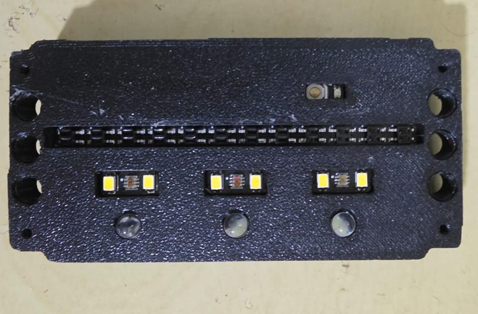

# `CorReflexao` — sensor de linha e cor Pro1616 (V2)

Arquivo: `sensorCorReflexao.py` **versão V2** (`exemplos/11-sensorCorReflexaoV2/` e
`libs_mariola/` dos simuladores) · `from sensorCorReflexao import CorReflexao`

> **Atenção:** a pasta `libs/` ainda tem a versão antiga (V1, 32 bytes, `set_modo`, `posicao()`,
> importa `libs.cronometro`). Ela **não funciona** com o firmware novo do Pro1616 (16 bytes,
> comando `0x61`). Use a V2: copie a de `exemplos/11-sensorCorReflexaoV2/` para o seu projeto.
> As diferenças estão no fim desta página.

## Para que serve



*A face que fica virada para o chão: a fileira de sensores IR (faixa preta comprida); um pouco
atrás dela, os três sensores de cor TCS34725, cada um entre dois LEDs brancos SMD; abaixo de cada
TCS, um LED branco de 5 mm de alto brilho (as lentes redondas), que reforça a iluminação e é o que
permite ler a reflexão alta de superfícies refletivas como a fita prata; no canto de cima, o botão
de reset da placa. Vista de baixo, a esquerda e a direita do robô aparecem trocadas.*

É o "olho no chão" do robô da Rescue Line (e o leitor de piso da Maze). Uma placa com:

* **12 sensores infravermelhos ITR8307** em fila, agrupados em **4 canais** de 3. Cada canal diz
  o quanto aquele trecho do chão reflete: **0 = preto, ~100 = branco calibrado, acima de 100 =
  mais brilhante que o branco (prata)**.
* **3 sensores de cor TCS34725** (esquerda = 1, meio = 2, direita = 3), um pouco atrás da fila de
  IR (no robô de exemplo, 9 mm), que dão R, G, B e C (claridade). Calibrados no branco e mandados
  pela **metade**: **branco ≈ 127**, o que sobra até 255 é para o prata.

```
              ← esquerda do robô                     direita →
 IR:   [canal 0: 3 ITR] [canal 1: 3 ITR] [canal 2: 3 ITR] [canal 3: 3 ITR]
 TCS:        [TCS 1]           [TCS 2 (meio)]          [TCS 3]
```

Para que cada parte serve:

| Parte | Use para |
|---|---|
| 4 canais IR | **seguir a linha** (rápido, ~50 leituras/s), achar interseção, gap, prata (IR > 100) |
| 3 TCS | **cores**: marcadores verdes, fita vermelha da chegada, prata, azul/preto da Maze |

## Como funciona

Ao criar o objeto, uma **thread** pede os 16 bytes ao sensor sem parar (115200 baud). Os métodos
de leitura só devolvem os últimos valores recebidos: são instantâneos, pode chamar à vontade.

| Bytes | Conteúdo |
|---|---|
| 0–3 | reflexão IR dos 4 canais |
| 4–7 | TCS1: R, G, B, C |
| 8–11 | TCS2 (meio): R, G, B, C |
| 12–15 | TCS3: R, G, B, C |

## Criando o objeto

### `CorReflexao(porta_serial, arquivo_cores=None, limiar=6.0, usar_ir=False)`
```python
sensor = CorReflexao(Portas.SERIAL6, arquivo_cores='cores_line.json')
sensor.usa_cores(['branco', 'preto', 'verde', 'vermelho', 'prata'])
while not sensor.conectado:      # espera a primeira leitura (logo após criar, tudo é 0)
    time.sleep(0.01)
```

* `arquivo_cores`: JSON com as cores aprendidas no campo (se existir, carrega).
* `limiar`: quão longe (em "desvios") uma leitura pode estar da cor para ser aceita.
* `usar_ir`: usar também o IR do lado de cada TCS na decisão da cor. **Desligado por padrão**
  (ver "Cuidados importantes").

## Leitura crua

### `le_reflexao()` → `[ir0, ir1, ir2, ir3]`
Os 4 canais IR. **O método do seguidor de linha.**

### `reflexao(sensor)` → um canal (0 a 3)

### `le_rgbc(sensor)` → `[R, G, B, C]` · `le_rgb(sensor)` → `[R, G, B]`
Do TCS 1, 2 ou 3. Branco ≈ (127, 127, 127, 127), preto perto de 0.

### `le_hsv(sensor)` → `[H, S, V]`
Matiz 0–360, saturação 0–100, valor 0–100 (branco ≈ 50). Bom para regras simples ("verde é H
entre 90 e 170 com S > 30").

### `le_hsv120(sensor, valor_maximo=255)` → `[H, S, V]` na escala 0–120 (como o Paint antigo)

### `rgb_para_hsv(r, g, b)` · `rgb_para_hsv120(r, g, b, valor_maximo)` *(estáticos)*
Conversões avulsas.

### `valores` *(propriedade)* → os 16 bytes · `conectado` *(propriedade)*
`conectado` é `True` se o sensor respondeu nos últimos 2 s.

## Classificação de cor por referências

Cada cor é uma **referência**: média e desvio de quatro características da leitura —
cromaticidade `r/(r+g+b)`, `g/…`, `b/…` (a cor em si, não depende do brilho) e brilho `C/127`
(e uma quinta, IR `/100`, só com `usar_ir=True`). A leitura vai para a cor mais próxima; se nenhuma
estiver perto (`limiar`), dá `'desconhecida'`. Com pouca luz (preto) a cromaticidade não conta,
porque vira ruído: aí só o brilho decide.

### `cor(sensor=2)` → nome da cor no TCS 1, 2 ou 3
`'branco'`, `'preto'`, `'verde'`, `'vermelho'`, `'azul'`, `'amarelo'`, `'prata'` ou
`'desconhecida'`.

### `cores()` → `[cor TCS1, cor TCS2, cor TCS3]`
**O método para os marcadores verdes**: verde no TCS 1 = verde à esquerda, no 3 = à direita.

### `cor_piso()` → votação dos 3 TCS (sem maioria, vale o do meio)
**O método da Maze** (cor do ladrilho embaixo do robô).

### `detecta_cor(sensor)` → a cor como constante `COR_*`
`COR_NADA` (-1, sensor sem resposta), `COR_PRETO` 0, `COR_BRANCO` 1, `COR_VERMELHO` 2,
`COR_VERDE` 3, `COR_AZUL` 4, `COR_AMARELO` 5, `COR_DESCONHECIDA` 6, `COR_PRATA` 7.
`nome_cor(sensor)` é o mesmo que `cor(sensor)`. `NOMES_CORES` e `CODIGO_COR` convertem.

### `detectar_cor(r, g, b, c, ir=None)` → constante `COR_*` de um RGBC avulso

### `distancias(sensor=2)` → `[(distância, nome), ...]` ordenado
**Para depurar**: mostra o quão perto a leitura está de cada cor. Se a cor certa aparece em
segundo lugar com distância parecida, aprenda as cores de novo.

## Ensinando as cores (calibração no campo)

As referências que vêm na lib (`REFERENCIAS_PADRAO`) são só um começo. Luz do local, altura do
sensor e o material das fitas mudam tudo. No tempo de calibração da competição:

### `usa_cores(nomes)`
Deixa só as cores que existem na prova. **Sempre use**: menos cores = menos confusão.
Line: `['branco', 'preto', 'verde', 'vermelho', 'prata']`. Maze: `['branco', 'preto', 'prata',
'azul', 'vermelho']`.

### `aprende_cor(nome, amostras=25, intervalo=0.03, sensores=(1, 2, 3))`
Robô **parado** com os TCS sobre a cor: lê várias vezes e grava média e desvio. Leva ~1 s.

* Use `sensores=(2,)` se só o do meio está sobre a cor (fita estreita).

### `esquece_cor(nome)` · `salva_cores(arquivo)` · `carrega_cores(arquivo)`
Grava/lê as referências em JSON. `carrega_cores` devolve `False` se o arquivo não existe.

Programa pronto para isso: `calibra_cores.py` do exemplo (simulador da Maze e da Line).

## Calibração do firmware (o "zero" e o "cem")

### `calibra_branco(timeout_ms=10000)`
Sensor sobre o **branco**: o firmware ajusta os LEDs IR e o branco dos TCS (~7 s). `True` se
confirmou. Depois disso branco = ~100 no IR e ~127 no TCS.

### `calibra_preto(timeout_ms=5000)`
Sensor sobre o **preto** (~2 s).

* **Quando:** sensor novo, mudou a altura do sensor, ou leituras do branco muito longe de 100.
  Fica gravado no sensor. Depois de calibrar o firmware, ensine as cores de novo.

### `atualiza()` · `fechar()`
`atualiza` faz uma leitura (a thread já faz). `fechar` para a thread e fecha a serial.

## Cuidados importantes

* **Logo depois de criar, tudo é zero** (a primeira leitura ainda não chegou): espere
  `sensor.conectado`. Senão o robô "vê preto" no começo.
* **Por que o IR vem desligado na classificação.** A fileira de IR fica ~9 mm **à frente** dos
  TCS. Numa curva ou na borda da linha, o IR já está no branco enquanto o TCS ainda está no preto.
  Com pouca luz, a lib ignora a cromaticidade e sobram brilho e IR; a combinação "escuro no TCS,
  claro no IR" não bate com o preto (IR errado) nem com o branco (brilho errado), e caía no
  meio-termo: **"vermelho" ou "verde"**. No simulador isso fez o seguidor "chegar" no meio da
  pista. Com `usar_ir=False` (o padrão desde 17/10/2026), o escuro vai para o preto. Se ligar o IR
  para testar, saiba que esse erro volta.
* **Confirme decisões importantes.** Uma leitura isolada pode pegar a borda de uma fita. Para
  chegada e interseção, confirme em 2–3 leituras seguidas e/ou pelo RGB:

```python
def eh_verde(tcs):
    r, g, b, c = sensor.le_rgbc(tcs)
    return sensor.cor(tcs) == 'verde' and g > 1.4 * r and g > 1.15 * b and c > 20

def eh_vermelho(tcs):
    r, g, b, c = sensor.le_rgbc(tcs)
    return sensor.cor(tcs) == 'vermelho' and r > 1.8 * g and r > 1.8 * b and c > 20
```

* **Prata x lombada x rampa:** o IR passa de 100 no prata, mas também quando o sensor chega
  **mais perto** do chão (em cima da lombada, no pé da rampa). Confirme o prata com o TCS
  (`'prata'`), com o giroscópio (robô nivelado) e com a faixa de valores.
* **Altura importa muito:** o ITR8307 muda bastante com poucos milímetros. Fixe bem o sensor.

## Versão antiga (V1, `libs/sensorCorReflexao.py`)

| V1 | V2 |
|---|---|
| 32 bytes, modos 0–5 (`set_modo`) | 16 bytes, comando único `0x61` |
| `le_hsv` vinha do firmware (índices 20–28), `posicao()` (índice 29) | HSV calculado no Python; sem `posicao()` |
| `detecta_cor` esperava branco > 230 | referências aprendidas (`aprende_cor`), branco ≈ 127 |
| importa `from libs.cronometro`, `from libs.portas` | importa `from portas` |

## No simulador

O Pro1616 é emulado com os 12 ITR8307 e os 3 TCS na posição do `sensor_linha` do `robo*.json`,
com a curva de leitura × altura do ITR8307, os valores de cada material em `cores_piso` e a taxa
de 50 Hz do firmware.
