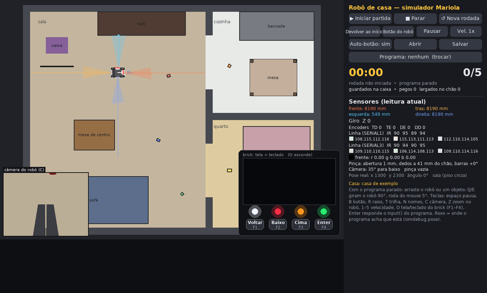
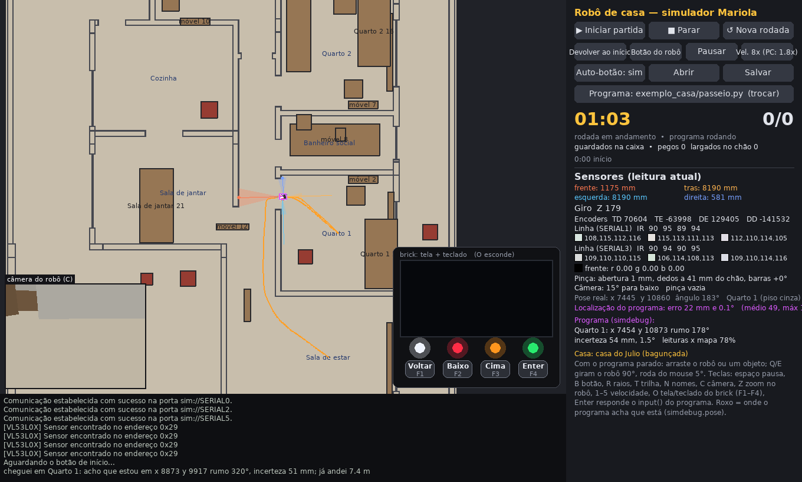
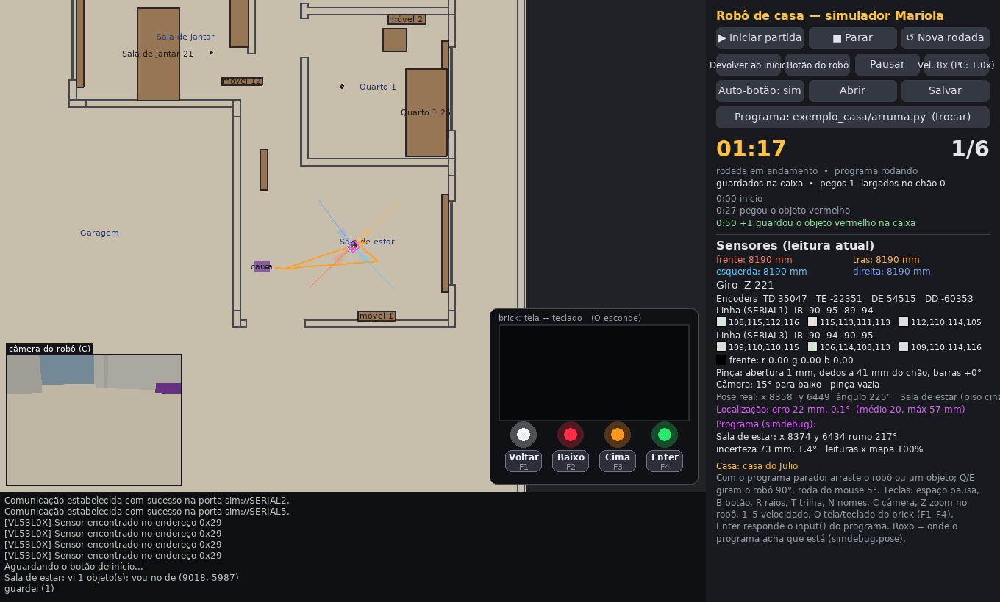
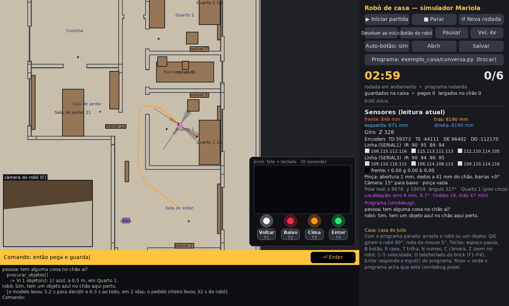
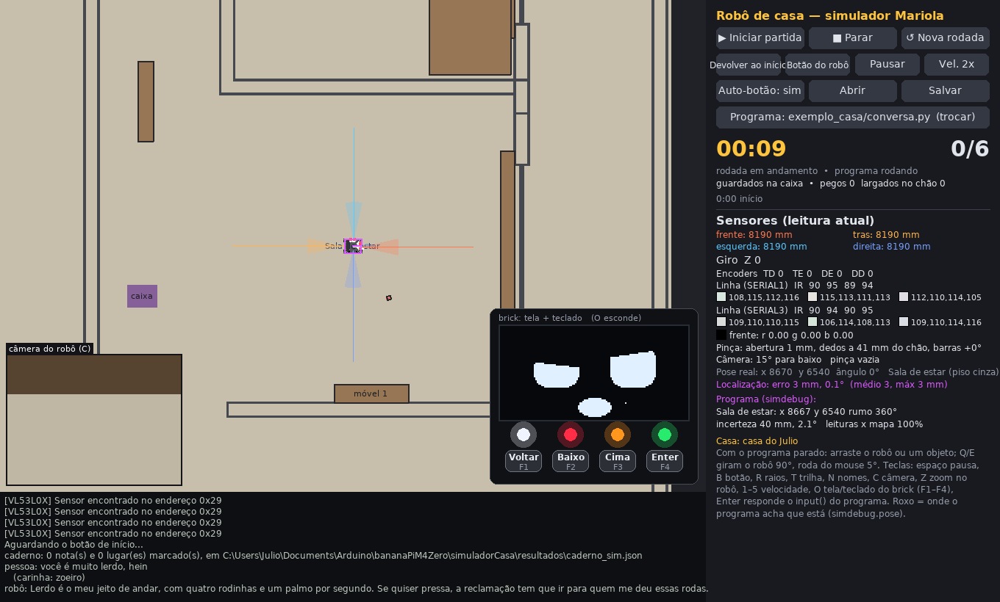

# simuladorCasa — o robô de casa no simulador

Simulador 2D de uma casa (cômodos, paredes, móveis) para o **Bombertinho de casa**: o robô da RCB
Challenge com uma pinça só, na frente, e uma câmera na cabeça da garra. Ele procura objetos no chão,
pega e guarda numa caixa. Os objetos, por enquanto, são prismas coloridos.

O programa do robô é o mesmo que roda no brick Mariola: usa as bibliotecas reais (`libs_mariola/`) e o
`cv2.VideoCapture` de sempre. O simulador responde pelos motores, servos, giroscópio, VL53, sensores de
linha e pela câmera.



## Abrir

```
Simulador.bat
python simulador.py                                  (casa de exemplo, programa exemplo_casa/main.py)
python simulador.py --casa casas/casa_julio.json     (a planta do Julio)
python simulador.py --programa meu/main.py
python simulador.py --sem-janela --velocidade 8      (uma rodada sem janela; imprime o resultado)
```

Precisa de `pygame`, `pymunk`, `numpy` e `opencv-python` (`pip install -r requirements.txt`).

### Janela

| tecla / mouse | o que faz |
|---|---|
| arrastar | com o programa parado, move o robô ou um objeto |
| Q / E, roda do mouse | gira o robô 90° / 5° |
| Z | zoom que acompanha o robô: 1x, 2,5x, 5x, 10x (casa grande) |
| C | mostra/esconde a imagem da câmera (canto de baixo, à esquerda) |
| N | nomes dos cômodos e dos móveis |
| R / T | raios dos VL53 / trilha do robô |
| B | botão de início do robô |
| O, F1–F4 | tela e teclado do brick |
| espaço, 1–5 | pausa, velocidade |

O painel mostra as leituras dos sensores, a pinça (abertura, altura dos dedos, ângulo das barras), a
inclinação da câmera, a pose real e o cômodo em que o robô está. A pose e o cômodo são do simulador: o
programa não tem acesso a eles (é o que ele vai ter de descobrir).

## O robô (`robo_casa.json`)

A base, as rodas mecanum, os VL53 (frente, trás, esquerda, direita; alcance de 1,2 m), o giroscópio e os
dois sensores de linha são os do Bombertinho (`simuladorChallenge/robo_bombertinho.json`), nos mesmos
lugares. A garra da esquerda saiu e a da frente virou a pinça do modelo 3D
(`Documents\modelos3D\robotica\roboCasa\garra\garra.py`):

| servo | o que faz | ângulo |
|---|---|---|
| SERVO3 | sobe/desce o braço de paralelogramo (barras de 75 mm) | 60 = barras na horizontal; −32,2° = dedos no chão; +66,9° = por cima da caixa de 10 cm |
| SERVO4 | abre a pinça (0,4887 mm por grau) | 10 = fechada (1 mm); 172 = 80 mm |
| SERVO2 | inclina a câmera | 60 = horizontal; +85° para baixo, −60° para cima |

Fechando a pinça com um objeto no meio dos dedos (até 80 mm de largura) e os dedos na altura dele, o
objeto fica preso e sobe com a garra. Abrindo, ele cai onde estiver: dentro da caixa conta como
guardado, fora dela como largado no chão.

### Câmera

`cv2.VideoCapture(0)` (ou `'/dev/video0'`) devolve a imagem da câmera da cabeça: 320 × 240, 15 quadros
por segundo, campo de 76° na diagonal (64° × 50°), com um pouco de ruído. A imagem é desenhada em 3D
(chão, paredes, móveis, caixa, objetos e os dedos da própria garra), então muda com a altura do braço e
com a inclinação da câmera. O resto do OpenCV é o de verdade.

Não há sombra, reflexo, desfoque de movimento nem textura no piso: é uma imagem limpa demais. Um filtro
de cor que funciona aqui pode não funcionar na casa de verdade.

## A casa (`casas/*.json`)

Medidas em mm, origem no canto de baixo à esquerda, x para a direita, y para cima.

```json
{
 "nome": "casa de exemplo",
 "largura": 4200, "altura": 3200,
 "parede": {"esp": 100, "alt": 2500, "rgb": [236, 232, 220]},
 "pisos":   [{"nome": "sala", "cor": "cinza", "ret": [0, 0, 2600, 3200], "rgb": [196, 182, 158]}],
 "faixas":  [{"cor": "preto", "ret": [150, 2380, 650, 2400]}],
 "paredes": [{"ret": [2600, 0, 2700, 450]}, {"de": [0, 1000], "ate": [800, 1000], "esp": 150}],
 "moveis":  [{"nome": "sofá", "ret": [150, 60, 1750, 760], "alt": 750, "rgb": [92, 110, 140]},
             {"nome": "mesa", "ret": [3250, 1950, 3950, 2500], "base": 720, "alt": 30}],
 "objetos": [{"cor": "vermelho", "x": 2050, "y": 2250, "ang": 15, "tam": [40, 40, 60]}],
 "caixa":   {"x": 400, "y": 2700, "ang": 0, "tam": [320, 240], "alt": 100, "rgb": [140, 70, 180]},
 "rotulos": [{"nome": "Sala de estar", "x": 8670, "y": 6540}],
 "inicio":  [1300, 2300, 0]
}
```

* `pisos`: `cor` é o que os sensores de linha leem; `rgb` é a aparência (janela e câmera).
* `paredes`: as de fora são criadas sozinhas em volta de `largura` × `altura` (`"externas": false` em
  `parede` desliga). As de dentro são retângulos (`ret`) ou segmentos (`de`, `ate`, `esp`). Porta = vão.
* `moveis`: `base` > 0 é um tampo no ar (o robô passa por baixo se couber; as pernas são móveis pequenos).
* `objetos`: `tam` = comprimento, largura, altura. A pinça pega até 80 mm de largura.
* `rotulos`: nomes de cômodos de uma planta importada (só para a janela e para o painel).

`casas/casa_exemplo.json` tem sala, quarto e cozinha (4,2 × 3,2 m), cinco prismas e a caixa roxa.

### A planta de uma casa de verdade

`ferramentas/planta_dxf.py` converte uma planta em DXF: as linhas da camada `PAREDE` viram paredes, as
da `ESQUADRIA` (janelas) também, e os retângulos da camada `LAY OUT` viram móveis.

```
python ferramentas/planta_dxf.py planta.dxf casas/minha_casa.json --unidade cm --ver planta.png
ferramentas\converte_casa_julio.bat        (refaz casas/casa_julio.json)
```

`casas/casa_julio.json` saiu da planta "ILUMINAÇÃO E GESSO" (12,1 × 25,2 m, 283 linhas de parede, 29
móveis, 15 cômodos com nome). A conferir nela:

* as esquadrias entraram como parede: uma porta de correr desenhada como janela fecha a passagem (apague
  a linha, ela tem `"tipo": "janela"`);
* os nomes vêm dos blocos do desenho; "z" = Cozinha e "al" = Área de lazer são palpites;
* os móveis são os do projeto, com 45 cm de altura todos; os retângulos finos junto das janelas devem
  ser cortineiros do gesso e não móveis;
* o piso é um só (cinza) no terreno inteiro;
* a caixa (na sala de estar) e os seis prismas foram postos pelo `ferramentas/espalha_objetos.py`;
  refazer a planta pelo `.bat` não apaga os dois.

## O exemplo (`exemplo_casa/`)

* `robo.py`: camada de hardware (`move`, `gira`, `anda`, `desliza`, `garra`, `foto`, `distancia`,
  `distancias` dos quatro VL53 de uma vez, `rodas`).
* `teste_basico.py`: liga tudo e confere motores, servos, giroscópio, VL53 e câmera.
* `main.py`: gira até ver um objeto colorido, vai até ele, pega, gira até ver a caixa roxa e guarda.
  É a versão sem mapa (a com mapa é o `arruma.py`, mais abaixo).

Na casa de exemplo ele guarda os cinco prismas em 7 min 34 s (tempo simulado). Ele não sabe onde está:
acha tudo pela cor, e quando um móvel fica no caminho ou a caixa não aparece, recua, sai de lado ou
anda um pouco e tenta de novo. Numa casa de verdade isso não basta, e é para isso que serve o simulador.

## Localização e navegação



O robô carrega o mesmo JSON da casa como mapa e, sabendo de onde saiu (o `inicio`, a base dele),
acompanha onde está e vai de um cômodo a outro pelo nome.

| arquivo | o que faz |
|---|---|
| `exemplo_casa/mapa.py` | `Mapa`: o que os VL53 deveriam ler num lugar (`raios`), rota entre dois pontos desviando de paredes e móveis (`rota`), nome do cômodo de um ponto (`comodo`) e ponto de um cômodo (`lugar`) |
| `exemplo_casa/localiza.py` | `Localizador`: filtro de partículas com os 4 encoders, o giroscópio e os 4 VL53. `pose()` = (x, y, rumo) no mapa; `incerteza()` = o quanto ele confia |
| `exemplo_casa/navega.py` | `Navegador`: `vai_para(x, y)`, `vai_para_comodo('Cozinha')`, `vira_para(rumo)` |
| `exemplo_casa/passeio.py` | teste: visita todos os cômodos e volta para o início |

```
python simulador.py --casa casas/casa_julio.json --programa exemplo_casa/passeio.py
```

Na janela, o contorno roxo é onde o programa acha que o robô está, e o painel mostra o erro em relação à
pose de verdade. Sem janela, o erro médio e o máximo saem no resultado.

Medido na casa do Julio (passeio pelos 15 cômodos, 97 m, 9 min 38 s simulados):

| situação | erro médio | erro máximo |
|---|---|---|
| casa igual ao mapa | 20 mm | 95 mm |
| casa bagunçada (4 móveis a menos, os outros até 15 cm fora do lugar, 14 coisas fora do mapa) | 49 mm | 290 mm |

E num trajeto de 26 m (sala > quarto 1 > cozinha > sala):

| situação | com os VL53 | só odometria e giroscópio |
|---|---|---|
| robô como o programa supõe | 19 mm (máx 56) | 33 mm (máx 115) |
| robô mal calibrado (roda 3% menor, 20% de perda de lado, giroscópio derivando 3°/min) | 28 mm (máx 79) | 210 mm (máx 620) |

Para repetir esses testes:

```
python simulador.py --casa casas/casa_julio.json --programa exemplo_casa/passeio.py --sem-janela --velocidade 8 --tempo 1800
python ferramentas/bagunca_casa.py casas/casa_julio.json casas/casa_julio_baguncada.json
python simulador.py --casa casas/casa_julio_baguncada.json --mapa casas/casa_julio.json --programa exemplo_casa/passeio.py ...
python simulador.py ... --ajuste "rodas.diametro=56,rodas.eficiencia_lateral=0.8,giroscopio.deriva_graus_min=3"
```

`--mapa` dá ao robô um mapa diferente da casa aberta; `--ajuste` troca valores do `robo_casa.json` só
naquela execução. As variáveis de ambiente `CASA_ROTA="Quarto 1,Cozinha"` e `CASA_SEM_VL53=1` mudam o
passeio.

O que esses números não dizem:

* O simulador é bondoso: o chão é liso, as paredes estão onde a planta diz e o VL53 erra pouco. Na casa
  de verdade o erro vai ser maior; os números servem para comparar soluções, não para prometer 2 cm.
* O filtro acompanha a posição a partir de um início conhecido. Se o robô for levado no colo para outro
  lugar, ele não se acha de novo.
* O navegador não desvia do que não está no mapa: se fica preso, recua e refaz a rota.
* Com os VL53 a 1,2 m, no meio de um cômodo grande a posição segue só pela odometria até o robô passar
  perto de uma parede. A câmera ainda não ajuda na localização.

## Arrumar a casa com o mapa (`exemplo_casa/arruma.py`)



Junta as duas coisas: o robô percorre os cômodos, acha os objetos pela câmera, pega e leva até a caixa
pela rota do mapa.

```
python simulador.py --casa casas/casa_julio.json --programa exemplo_casa/arruma.py
```

1. Vai até o cômodo mais perto que ainda não olhou. No caminho, a cada poucos passos tira uma foto do
   chão à frente: objeto no caminho é pego e guardado na hora (senão o robô o empurraria).
2. No cômodo, recua um palmo e gira uma volta olhando. Cada mancha de cor viva vira um ponto no mapa
   (pelo pixel em que ela encosta no chão, mais a pose do robô) e um tamanho em mm. O que é grande
   demais para a pinça (mais de 11 cm, até 90 cm) é uma **coisa grande**: veja abaixo.
3. Vai pela rota até 45 cm do objeto mais perto, vira para ele, chega pela câmera e pega.
4. Vai pela rota até a frente da caixa (ela está no mapa), vira para ela e guarda.
5. Volta ao cômodo e olha de novo. Nada à vista: cômodo arrumado, próximo.

**Coisas grandes** (uma camiseta, um brinquedo grande): a pinça não pega, então o robô deixa no chão,
marca no mapa como obstáculo (as rotas passam a desviar, para ele não se enroscar nem empurrar) e avisa:
no fim do `arruma.py` sai a lista, e pelo cérebro ele conta na resposta ("tem uma coisa azul grande no
chão do quarto do casal que eu não consigo pegar"). Se viu uma no caminho, para, marca e refaz a rota.
Se olha em volta de novo e ela não está mais lá (alguém recolheu), sai do mapa. Se ela fecha a passagem
para um cômodo (uma camiseta na porta), ele não passa por cima: avisa que uma coisa grande no chão fecha
a passagem e segue para os outros cômodos. Por enquanto "grande" é
só o tamanho da mancha de cor; no robô de verdade quem vai dizer isso, e se é roupa ou brinquedo, é a
rede neural da câmera. No simulador, um objeto com um lado de mais de 11 cm é grande e não conta no
placar (`"grande": true` no objeto da casa força).

`casas/casa_julio.json` tem a caixa na sala de estar, seis prismas em seis cômodos e duas coisas grandes:
uma "camiseta" azul (32 × 24 cm, 1,5 cm de altura) num canto do quarto do casal e um "caminhão de brinquedo"
laranja (28 × 16 × 12 cm) na sala de estar. Para outra disposição:

```
python ferramentas/espalha_objetos.py casas/casa_julio.json --n 8 --semente 3
python ferramentas/espalha_objetos.py casas/casa_julio.json --caixa 6400,6000 --comodos "Sala de estar,Cozinha"
```

Resultados (sem janela, semente 1):

| casa | resultado | tempo simulado |
|---|---|---|
| casa de exemplo (5 prismas) | 5 de 5 | 4 min 59 s (o `main.py`, só pela cor, leva 7 min 34 s) |
| casa do Julio (6 prismas em 6 cômodos, 15 cômodos olhados) | 6 de 6, erro de localização médio de 19 mm (máx 86) | 21 min 7 s |

O que ainda é frágil:

* O robô acha objeto só pela cor viva e pelo tamanho. Uma meia cinza no chão ele não vê. Um objeto
  pequeno encostado numa coisa grande colorida vira uma mancha só, e o robô o deixa junto com ela.
* Olhando do meio do cômodo ele enxerga um objeto de 4 cm até uns 2,5 m. Em áreas grandes (garagem, área
  de lazer) e atrás dos móveis ficam cantos sem olhar.
* Carregando um objeto ele não pega outro: se houver um no caminho, empurra.
* A caixa tem de estar onde o mapa diz.

## O cérebro: comandos em português

O robô recebe um pedido em texto ("vai para a cozinha", "tem alguma coisa no chão do quarto 1?",
"arruma a sala de jantar"), um modelo de linguagem decide que ferramentas chamar e responde em uma ou
duas frases (que depois serão faladas). O mesmo cérebro roda com dois tipos de modelo, para comparar:

| | Claude pela API | Claude pela mensalidade | modelo local |
|---|---|---|---|
| como | SDK `anthropic` | Claude Code (pacote `claude-agent-sdk`, que traz o Claude Code embutido) | Ollama num PC da casa |
| precisa de | internet, `pip install anthropic`, chave em `CEREBRO_CHAVE_API` | internet, `pip install claude-agent-sdk`, login feito uma vez (`ferramentas\login_claude.bat`) | o Ollama rodando (`ollama serve`), um modelo que aceite ferramentas |
| custo | por uso; os planos Max, Ultra e Team trazem um crédito mensal de API (US$ 100 no Max) que precisa ser resgatado, ver abaixo | sai do limite do plano | nenhum |
| escolher | `CEREBRO=claude` (padrão), `CEREBRO_MODELO=claude-haiku-5-5` (padrão) ou `claude-opus-5-5` | `CEREBRO=assinatura`, `CEREBRO_MODELO=haiku`, `sonnet` ou `opus` | `CEREBRO=local`, `CEREBRO_MODELO=<nome no Ollama>`, `CEREBRO_URL=http://ip:11434` |

Crédito de API do plano (conferido em 12/11/2026 em
https://platform.claude.com/docs/en/about-claude/api-credits-for-subscribers): o plano Max inclui US$ 100
por mês de crédito para a API e o Agent SDK (não vale para o Claude Code nem para uso extra no app). Para
resgatar: em claude.ai, Configurações > Cobrança > "API credits", ligar uma organização do Console
(platform.claude.com); depois criar uma chave de API nessa organização e gravar na variável
`CEREBRO_CHAVE_API` (no Windows: `setx CEREBRO_CHAVE_API "sk-ant-..."`). O nome é só do robô de
propósito: com `ANTHROPIC_API_KEY` no ambiente do PC, o Claude Code passaria a usar a chave no lugar do
login da mensalidade, e o crédito não cobre o Claude Code. Não precisa de cartão. O crédito não acumula de um mês para o outro, e quando acaba os pedidos param (nada é
cobrado, a menos que você compre crédito ou ligue a recarga automática). Com ele, `CEREBRO=claude` roda
sem custo adicional.

O caminho da mensalidade serve para testar e comparar sem gastar. O que ele consome sai do mesmo limite
do plano que você usa para trabalhar, e as regras do plano para uso automatizado como este não foram
conferidas: antes de adotar no robô do dia a dia, confira, ou use a API ou o modelo local.

| arquivo | o que faz |
|---|---|
| `exemplo_casa/cerebro.py` | as ferramentas (uma descrição só para os dois modelos), as instruções do robô, o laço "modelo pede ferramenta, programa executa, devolve o resultado" e os dois modelos |
| `exemplo_casa/habilidades.py` | o que cada ferramenta faz com o robô: `onde_estou`, `ir_para`, `procurar_objetos`, `pegar_objeto`, `guardar_na_caixa`, `soltar_objeto`, `arrumar`, `gesto`, `aprender`, `esquecer`, `marcar_lugar` |
| `exemplo_casa/memoria.py` | o caderno: notas e lugares marcados, num arquivo JSON |
| `exemplo_casa/conversa.py` | o programa do robô: lê o comando, chama o cérebro, mostra a resposta |
| `exemplo_casa/testa_cerebro.py` | bateria de 20 comandos numa casa de mentira (sem robô nem simulador), para comparar modelos |

No simulador (PowerShell):

```
$env:CEREBRO = 'local'
python simulador.py --casa casas/casa_julio.json --programa exemplo_casa/conversa.py
```

Quando aparecer a faixa amarela "Comando:", digite o pedido na janela e aperte Enter. "sair" termina.
Sem janela, os comandos vêm de `CASA_COMANDOS="vai para a cozinha; onde você está?"`.

A bateria de bancada:

```
python exemplo_casa/testa_cerebro.py local
python exemplo_casa/testa_cerebro.py assinatura assinatura:haiku
python exemplo_casa/testa_cerebro.py claude claude:claude-haiku-5-5 local:<outro modelo> --mostra
```

Ela confere cada comando pelo que aconteceu (onde o robô foi parar, o que foi guardado, se ele perguntou
em vez de adivinhar "qual banheiro?") e mede os segundos até o modelo decidir, que é o tempo em que o robô
fica parado depois da ordem. Os resultados ficam em `resultados/cerebro_<modelo>.json`.

Resultados em 12/11/2026, num PC com RTX 5060 Ti de 16 GB (20 comandos; "até agir" = segundos do modelo
antes da primeira ação, em média):

| modelo | acertos | até agir | observação |
|---|---|---|---|
| Claude Haiku 5.5 pela API (`CEREBRO=claude`, o padrão) | 20 de 20 e 19 de 20 (duas rodadas) | 1,1 s | US$ 0,009 a bateria inteira (0,05 centavo por comando); quando "erra" é o caso da pinça ocupada, em que ele pergunta antes de guardar o que segurava |
| Claude Opus 5.5 pela API (`CEREBRO_MODELO=claude-opus-5-5`) | 19 de 20 (duas rodadas) | 1,8 s | US$ 0,32 a bateria inteira (1,6 centavo por comando; US$ 0,57 sem o cache de prompt); o "erro" é honestidade: mandado voltar "pra onde estava", diz que não sabe onde estava e pergunta |
| Claude Opus 5.5 pela mensalidade (o modelo padrão da conta) | 20 de 20 | 3,0 s | mais lento que pela API: passa pelo Claude Code |
| Claude Haiku 5.5 pela mensalidade (`CEREBRO_MODELO=haiku`) | 19 de 20 | 1,1 s | |
| `qwen3.5:9b` (local, 6,6 GB, cabe inteiro na placa) | 20 de 20 | 4,3 s | o padrão do modelo local |
| `qwen3.5:9b` com `CEREBRO_PENSA=0` | 14 de 20 | 3,0 s | sem "pensar", às vezes responde que foi sem chamar a ferramenta |
| `qwen3-coder:30b` (local, 18 GB, 24% na CPU) | 15 de 20 | 3,8 s | faz mais do que foi pedido: mandado ir à cozinha, vai, pega o que acha e guarda |

Os custos são estimativas pelos tokens de cada chamada e pela tabela de preços (`PRECO_USD_MTOK` no
`cerebro.py`); a conta de verdade é a do Console. Com o crédito de US$ 100 por mês do plano Max, o Haiku
dá para uns 200 mil comandos e o Opus para uns 6 mil. Pela mensalidade nada é cobrado, mas sai do limite
do plano.

No simulador, com a casa do Julio, a conversa "oi, onde você está?", "vai para o banheiro" (ele pergunta
qual), "o social", "tem alguma coisa no chão do quarto 2?", "então guarda e volta pra base" terminou com
o prisma laranja na caixa e o robô na base com os três caminhos: `qwen3.5:9b` (3,6 s em média para
decidir), Claude Haiku pela mensalidade (1,2 s) e Claude Haiku pela API (1,0 s; nesta, um sexto comando,
"arruma a sala de estar", guardou também o prisma vermelho).



O que ainda é frágil:

* A bateria usa uma casa de mentira em que as ferramentas nunca falham por acaso; no simulador (e no
  robô) pegar e andar falham de vez em quando, e isso só foi exercitado em duas conversas curtas.
* Enquanto o modelo pensa, o robô fica parado: uns 4 s antes de cada ação com o modelo local, 3 s com o
  Opus e 1 s com o Haiku.
* A conversa cresce a cada comando e é mandada inteira de novo ao modelo; numa sessão longa isso custa
  tempo (local) ou dinheiro (API). Ainda não há resumo nem esquecimento.
* Com o comando digitado, uma ordem nova não interrompe a anterior; por voz (`CASA_VOZ=ouve`) interrompe.

### O jeito do robô

O Bombertinho é zoeiro: implica com a bagunça, faz drama com o esforço, conta vantagem, devolve
provocação e ri de si mesmo. As instruções disso estão em `JEITOS['zoeiro']`, no `cerebro.py`
(`CEREBRO_JEITO=serio` desliga). As regras que mantêm a graça sob controle: a piada vem junto com a
informação e nunca muda um fato; uma tirada por resposta; nada de zoar aparência, família, religião ou
política; se a pessoa pedir para parar, ele responde sério; e nada de "kkk" ou emoji, porque tudo é lido
em voz alta.

Ele também reage com o corpo pela ferramenta `gesto`: `comemorar`, `sim`, `nao`, `triste`,
`olhar_para_cima` e `dancinha`.

Uma amostra, com o Haiku (o padrão):

> **pessoa:** você é muito lerdo, hein
> **robô:** Lerdo é o meu jeito de caminhar com cuidado, e ando um palmo por segundo, então sou quase um
> caracol com ambição. Mas pelo menos não derrubei nada no caminho.

E com o Sonnet (`CEREBRO_MODELO=claude-sonnet-5-5`), que tem mais graça e custa quase 20 vezes mais
(1,3 centavo por comando contra 0,07):

> **pessoa:** agora sobe no sofá
> **robô:** Aí você me pegou: subir no sofá eu não consigo. Tenho uns vinte centímetros e quatro rodas, e o
> sofá é praticamente o Everest para mim. Se tiver algo no chão, aí eu resolvo.

Com o jeito zoeiro a bateria continuou em 19 a 20 de 20 no Haiku. Na primeira versão das instruções ele
inventou um cômodo ("Varanda") e um detalhe do corpo para fazer graça; por isso elas dizem o que ele é de
verdade e proíbem inventar coisas da casa.

### O rosto (`exemplo_casa/rosto.py`)



O rosto é a **tela do próprio brick** (conector TELA, OLED de 128 x 64): ela mostra uma de 28 carinhas
desenhadas por código (`imagens/carinhas_v1.png`; `python exemplo_casa/rosto.py folha.png` gera a folha).
No simulador é a tela do painel "brick: tela + teclado" da janela (tecla O mostra e esconde). O rosto muda
de três jeitos:

* **sozinho, pelo que o robô faz**: pensando (enquanto o modelo decide), procurando (olhando em volta),
  fazendo força (pegando), comemorando (guardou), triste (não conseguiu), surpreso (foi interrompido),
  sonolento e dormindo (um e três minutos sem ninguém falar com ele);
* **pela resposta do cérebro**: toda resposta começa com a carinha entre parênteses, "(zoeiro) Lerdo é
  elogio...", que não é falada e vira a cara dele enquanto fala (some depois de 25 s);
* **falando**: a boca mexe, com a carinha que for.

Os gestos do corpo também mudam a cara (comemorar, dizer não, dancinha). `CASA_ROSTO=0` desliga.

No robô de verdade a OLED pequena do brick (SSD1306 de 0,96") dá lugar à de 2,42" (SSD1309, também de
128 x 64), no mesmo conector: I2C 0, endereço 0x3C (`ROSTO_BARRAMENTO` e `ROSTO_ENDERECO` no `rosto.py`),
aberta pelo `luma.oled` como a lib `tela.py`. **Ainda não testado numa tela de verdade.** Sem tela o
programa segue normalmente. Enquanto o programa do rosto roda, a tela é dele: não use a `Tela` da
`tela.py` ao mesmo tempo (as duas escreveriam na mesma tela).

### O caderno: ensinar coisas ao robô

O modelo de linguagem não muda nem é treinado de novo; "aprender", aqui, é anotar. Quando alguém ensina
de propósito ("aprende aí", "lembra que", "de agora em diante"), o cérebro chama a ferramenta `aprender`
e a frase vai para um arquivo (`memoria/caderno.json`, ou o da variável `CEREBRO_MEMORIA`). No começo de
cada conversa as notas entram nas instruções dele e valem como regra da casa.

| você diz | o que acontece |
|---|---|
| "aprende aí: o quarto do Miguel é o quarto um" | nota no caderno; depois "vai no quarto do Miguel" funciona |
| "de agora em diante me chama de chefe" | nota de jeito de falar; ele passa a seguir |
| "nunca entre no banheiro do casal" | regra; mandado ir lá, ele recusa e diz por quê |
| "isso aqui é o cantinho da bagunça, guarda esse lugar" | `marcar_lugar`: o ponto do mapa onde ele está vira destino |
| "o que você aprendeu até agora?" | ele conta o que está no caderno |
| "esquece esse negócio de chefe" | `esquecer`: apaga a nota |

O arquivo é um JSON legível: dá para abrir, corrigir e apagar à mão. Limites: qualquer um que fale com ele
pode ensinar; o que ensinarem errado fica até alguém corrigir; o caderno tem no máximo 60 notas; e ele
ainda não aprende objetos ("isso é uma meia"), porque só reconhece cor.

Testado em 12/11/2026: na bateria, 7 casos de caderno, todos certos com o Haiku (29 de 30 no total); no
simulador, em duas conversas seguidas com o mesmo arquivo, aprendeu o apelido e o lugar na primeira e
usou os dois na segunda.

### Falar pouco

Ele responde em uma frase, duas no máximo, e não fala de distâncias, margem de erro, onde fica a caixa
nem "na pinça" (pedido do Julio depois de conversar com ele por voz). Isso está nas instruções e também
no que as ferramentas devolvem, que não trazem mais esses detalhes: o modelo repete o que lê.

## Voz: falar e ouvir (`exemplo_casa/voz.py`)

Tudo local, sem internet:

* **A voz do robô é a `cadu_desenho`** (`VOZ_ROBO`; as vozes ficam em `VOZES_ROBO` no `voz.py`). Lá também
  está a `thalita_robo` (edge-tts, `pip install edge-tts`), só para comparar: ela **precisa de internet**, e
  o Julio decidiu em 14/11/2026 que a voz do robô tem de ser gerada localmente.
* **Falar**: Piper (`pip install piper-tts`), com uma voz em português do Brasil na pasta `vozes/`
  (`python -m piper.download_voices --download-dir vozes pt_BR-cadu-medium`; há também `faber`,
  `edresson` e `jeff`). Leva 0,1 s para gerar uma frase no PC e tem versão para ARM (Banana Pi).
  A `cadu_desenho` é a `cadu` com o efeito `desenho` (tom bem mais fino, sem distorção; escolha do Julio
  em 12/11/2026). `VOZ_NOME` e `VOZ_EFEITO` trocam por uma voz do Piper: `nenhum` = a voz como ela é,
  `agudo` = um pouco mais fina; `robozinho`, `metalico`, `lata` e `grave` distorcem (ele ouviu e não
  gostou). Também ouviu o eSpeak NG e o Kokoro (amostras em `imagens/vozes/`), que não entraram.
* **Ouvir**: faster-whisper (`pip install faster-whisper`), modelo `large-v3-turbo` na placa de vídeo
  (0,2 s por frase) ou `small` na CPU.
* **Som**: `sounddevice`, para tocar e para gravar do microfone.

Não há palavra de chamada treinada: o robô grava cada frase (do primeiro som até o silêncio), transcreve
e só obedece se ela começar pelo nome dele ("Bombertinho, vai para a cozinha"), ou se vier até 20 s depois
de uma pergunta que ele fez ("Qual banheiro?" / "O social").

**Ele ouve enquanto trabalha.** No modo `CASA_VOZ=ouve` a escuta roda o tempo todo numa thread (`Escuta`).
Se alguém fala com ele no meio de uma tarefa (com o nome, ou um "para!" curto mesmo sem o nome), o robô
para na hora: cada `Robo.move()` consulta a escuta e levanta `Interrompido`, a ferramenta em curso é
desmontada (`Habilidades._interrompido`: motores parados, pinça num estado conhecido) e o resultado
"INTERROMPIDO: a pessoa falou ..." volta para o cérebro, que decide: ficar parado, trocar o pedido pelo
novo, ou responder e perguntar se continua. Enquanto o robô fala, a escuta fica surda, para ele não ouvir
a própria voz.

**Ele reconhece quem está falando.** Um modelo pequeno (ECAPA, do `speechbrain`) transforma cada frase
numa assinatura da voz (`voz.Quem`). A pessoa se apresenta uma vez ("Bombertinho, eu sou o Julio, grava a
minha voz"; as duas falas seguintes também são gravadas) e daí em diante cada pedido chega ao cérebro com
uma etiqueta: `[quem falou: Julio]`, `[quem falou: provavelmente Julio]` ou `[quem falou: voz que não
conheço]`. Com isso ele usa o nome e os recados de cada um que estão no caderno ("o Julio gosta de ser
chamado de professor"). "Apaga a minha voz" apaga. Uma voz que já tem dono não é gravada com outro nome.

**Quem ele reconhece não precisa repetir o nome dele.** Depois de responder a uma pessoa conhecida, por
40 segundos (`JANELA_CONVERSA_S`) as falas dela valem como continuação da conversa, mesmo sem
"Bombertinho". Essas falas chegam ao cérebro marcadas com "sem chamar pelo nome"; se a frase claramente
não é para um robô ("mãe, o almoço já está pronto?"), ele responde `SILENCIO` e fica quieto. Voz
desconhecida continua precisando do nome. No meio de uma tarefa continua valendo só o nome ou um "para!"
curto, para uma conversa ao lado não interromper o robô.

As assinaturas ficam só no computador, em `memoria/vozes.json` (fora do git): são dados biométricos das
pessoas da casa. Isso serve para personalizar, não para segurança: frase curta ("para!") não dá para
reconhecer, vozes parecidas se confundem e uma gravação engana. `VOZ_QUEM=0` desliga.

Medido com vozes de máquina (seis "pessoas", três frases de apresentação, dez de prova cada): 53 de 60
frases com a pessoa certa, 7 "não sei" (as frases curtas), nenhuma troca; uma voz desconhecida foi tomada
por alguém da casa em 9 de 60 frases, quase sempre entre vozes do mesmo sintetizador. 28 ms por frase.
**Com vozes de gente ainda não foi testado**, e o limite de semelhança (`Quem.LIMITE`) precisa ser
ajustado com as vozes da casa.

```
python exemplo_casa/testa_voz.py --quem              (reconhecimento de quem fala, com vozes de máquina)
python exemplo_casa/testa_voz.py --apresenta Julio   (grava a sua voz pelo microfone: 3 frases compridas)
python exemplo_casa/testa_voz.py --quem-fala 6       (grava 6 frases e diz quem falou cada uma, com as notas)
python exemplo_casa/testa_voz.py                  (teste fechado: o Piper fala cada comando e o whisper transcreve)
python exemplo_casa/testa_voz.py --ruido 10       (com ruído por cima)
python exemplo_casa/testa_voz.py --microfone 5    (com a sua voz: grava 5 frases e mostra o que entendeu)
python exemplo_casa/testa_voz.py --fala "Oi, eu sou o Bombertinho"
```

No simulador (PowerShell):

```
$env:CASA_VOZ = 'fala'      # o robô fala as respostas; o comando continua digitado na janela
$env:CASA_VOZ = 'ouve'      # fala e ouve pelo microfone do PC
python simulador.py --casa casas/casa_julio.json --programa exemplo_casa/conversa.py
```

Medido em 12/11/2026: no teste fechado, 16 de 16 frases entendidas com as duas vozes (15 de 16 com a
`faber` e ruído a 10 dB ou 3 dB), e o robô soube em todas se a frase era com ele. No simulador, com a voz
simulada (`CASA_VOZ=simulada`, os comandos falados por outra voz do Piper) e o Haiku: perguntou qual
banheiro, aceitou "o social" sem o nome, ignorou "hoje o jogo foi muito bom", achou e guardou o prisma
laranja.

O que isso não prova: o teste fechado usa fala de máquina, limpa. **O microfone de verdade ainda não foi
testado** (nem com a sua voz, nem de longe, nem com o barulho dos motores), e o corte da frase é pelo
volume, que falha em lugar barulhento. No robô de verdade o microfone fica nele e o reconhecimento num PC
da casa; hoje é tudo na mesma máquina. E no robô de verdade o microfone vai ouvir os próprios motores
enquanto ele anda, o que o simulador não imita.

## O que falta

* Localização: achar-se sem saber de onde saiu, desviar do que não está no mapa, usar a câmera
  (marcas nas paredes, por exemplo) para corrigir a posição nos cômodos grandes.
* Voz: testar com microfone de verdade, escolher a voz do robô, ouvir enquanto anda ("para!") e separar
  o microfone (no robô) do reconhecimento (no PC).
* Objetos de verdade no lugar dos prismas; pessoas; portas que abrem e fecham; degraus e tapetes.
* A tela de rosto, a caixa de som e o microfone do robô.
