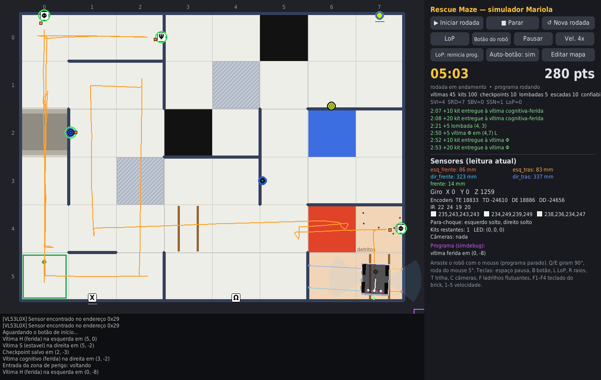

# Simulador RoboCupJunior Rescue Maze — robô com brick Mariola

Simulador 2D para desenvolver e testar **posicionamento, roteamento e descoberta do mapa** da
Rescue Maze (regra 2026) com o **mesmo código** que vai para o robô real.

O ponto principal: o programa do aluno importa as bibliotecas reais do Mariola
(`motores.py`, `placaControleMotor.py`, `giroscopio.py`, `vl53.py`, `sensorCorReflexao.py`,
`botoes.py`, ...) e elas rodam **sem nenhuma alteração**. O simulador troca só a camada de
baixo (porta serial, I2C, GPIO e relógio) e emula o firmware de cada placa byte a byte.



---

## Instalação

Python **3.11 ou mais novo** (no Windows, as versões antigas dormem em passos de 15 ms e deixam o
laço de controle lento demais).

```bash
pip install pygame pymunk pillow
```

Funciona no Windows e no Linux. No Linux, para os diálogos de abrir/salvar mapa, instale também
`python3-tk` (sem ele, "Abrir" passa para o próximo mapa da pasta `mapas/` e "Salvar como" cria `mapaN.json`).

## Uso rápido

```bash
# abre a janela com o programa de exemplo
python simulador.py

# com o programa da equipe (troque pelo caminho do main.py de vocês) e outro mapa
python simulador.py --programa CAMINHO/DO/main.py --mapa mapas/exemplo1.json

# sem janela: roda uma rodada inteira 4x mais rápido e imprime o placar (bom para testar várias vezes)
python simulador.py --programa CAMINHO/DO/main.py --mapa mapas/exemplo1.json --sem-janela --velocidade 4
```

Opções: `--robo outro_robo.json`, `--semente N` (repete a mesma rodada), `--lop botao|reiniciar`,
`--tempo 480`, `--resultado arq.json` (sem janela: grava o placar em JSON), `--tempo-real` (modo
antigo do relógio, veja abaixo).

## Desafios e avaliação automática (`avalia.py`)

Uma rodada só não diz se o programa é bom: o ruído muda com a semente e uma rodada de sorte
engana. O `avalia.py` roda o programa em várias sementes, sem janela, mostra uma tabela com cada
rodada, a média e a pior, e confere a meta do desafio.

```bash
python avalia.py --lista                                        # os desafios (M01 a M06)
python avalia.py --desafio M02 --programa CAMINHO/DO/main.py    # roda o desafio e confere a meta
python avalia.py --programa CAMINHO/DO/main.py --mapa mapas/exemplo1.json --sementes 1-3
python avalia.py --programa CAMINHO/DO/main.py --surpresa medio --mapas 3   # 3 labirintos sorteados
```

* Rodadas em paralelo (`--paralelo N`; padrão: metade dos núcleos do PC). Como o relógio é
  sincronizado (abaixo), rodar em paralelo não muda o resultado.
* Os desafios ficam em `desafios/desafios.json` e os mapas em `desafios/mapas/`.
* Cada avaliação grava um relatório em `resultados/` (placar de cada rodada, se cumpriu a meta e
  uma impressão digital dos `.py` do programa) e o log de cada rodada em `resultados/logs/`.
* `--aluno "Nome"` põe o nome no relatório. `--semente-mapas N` troca os labirintos surpresa.

**Labirinto surpresa:** `python ferramentas/labirinto_surpresa.py --nivel facil|medio|dificil
--semente N` grava em `mapas/` um labirinto sorteado (paredes, buracos pretos, pratas, azuis,
lombadas, detritos e vítimas de letra e cognitivas, conforme o nível). No difícil há ilhas e
salas abertas: seguir a parede não visita tudo.

### Relógio sincronizado: o resultado não depende da velocidade nem do PC

O programa do aluno roda num processo separado e cada volta do laço gasta alguns milissegundos de
PC (ler sensores pelo socket, calcular). Se o relógio simulado andasse junto com o relógio real,
em 4x cada milissegundo de PC "custaria" 4 ms de robô, e o resultado mudaria com a velocidade, com
o PC e com o que mais estivesse rodando nele.

Por isso o padrão é o **relógio sincronizado** (o mesmo da Line): o tempo do programa só anda
quando todas as threads dele estão esperando (`time.sleep`, espera da serial ou do I2C). Nessa
hora o simulador avança a física exatamente até o primeiro despertar. O tempo que o PC gasta
calculando não conta; as esperas contam como no robô.

* Com a mesma semente, o mesmo mapa e o mesmo programa, a rodada sai **igual** em 0,25x, 1x ou 4x,
  com ou sem janela, em paralelo, inclusive com LoP. Sem `--semente`, uma semente é sorteada e
  repetida a cada "Nova rodada".
* **Vel.** passa a ser um limite. Se o PC não acompanha, o botão mostra quanto conseguiu, por
  exemplo `Vel. 4x (PC: 1.7x)`. O resultado não muda.
* No robô o laço também gasta tempo calculando: um `time.sleep(0.01)` no laço principal deixa os
  dois parecidos. A detecção de vítimas espera `deteccao.tempo_processamento_s` (no `robo.json`)
  depois da foto, como o processamento da imagem no robô: meça no seu e ajuste.
* Uma thread que fica calculando sem nunca esperar (laço sem `sleep`, ou presa num `Lock`) trava
  esse esquema. Depois de 1 s real nessa situação, o tempo passa a andar pelo relógio real.
* `--tempo-real` volta ao modo antigo: o programa usa o relógio real multiplicado pela velocidade.

### Na janela

| Botão / tecla | O que faz |
|---|---|
| **▶ Iniciar rodada** (F5) | zera o placar, põe o robô no início, inicia o programa e o cronômetro de 8 min |
| **■ Parar** | manda `KeyboardInterrupt` para o programa (como Ctrl+C) e, se não sair em 2 s, mata o processo |
| **↺ Nova rodada** | para tudo, volta o robô ao início e apaga os arquivos de `arquivos_rodada` (o checkpoint salvo) |
| **LoP** (L) | falta de progresso: robô volta ao último checkpoint visitado |
| **LoP: reinicia prog. / só botão** | o que acontece num LoP: desliga e liga o programa (testa o checkpoint salvo em arquivo) ou só aperta o botão de início |
| **Programa: pasta/arquivo (trocar)** | escolhe outro `.py` sem fechar o simulador: para o que está rodando, volta à rodada nova (apaga os `arquivos_rodada` da pasta do programa novo) e o próximo ▶ Iniciar já roda o escolhido |
| **Botão do robô** (B) | aperta o botão de início (pino P3) |
| **Auto-botão** | aperta o botão sozinho 1,5 s depois que o programa inicia |
| **Pausar** (espaço) / **Vel.** (1–5) | pausa ou muda a velocidade (0,25x a 4x). O resultado é o mesmo em qualquer velocidade |
| arrastar o robô / Q, E / roda do mouse | reposiciona o robô (com o programa parado) |
| R, T, C, F | raios dos VL53, trilha, campo das câmeras, ladrilhos flutuantes (roxo) |
| F1–F4 / clique | botões do teclado do brick (`teclado.py`): Voltar, Baixo, Cima, Enter |
| O | mostra/esconde a tela e o teclado do brick |

O painel mostra o tempo, a pontuação item por item, os eventos do juiz, as leituras dos sensores
e a saída (`print`) do programa no console de baixo.


### Tela OLED e teclado do brick

A placa da tela + teclado (conector TELA, barramento I2C 0) aparece no canto de baixo à direita do
mapa: a tela 128x64, os 4 LEDs (branco, vermelho, laranja, verde) e os 4 botões (Voltar, Baixo,
Cima, Enter). Clique nos botões ou use F1–F4; **O** esconde o painel. A `tela.py` e a `teclado.py`
rodam sem mudar: o simulador troca o `luma.oled` por uma tela virtual (o desenho é feito com o
Pillow, como no robô) e traz a fonte DejaVu em `fake_hw/fontes/` para o caminho do Linux funcionar
no Windows. No robo.json: `"tela"` (barramento e endereço) e `"teclado"` (barramento, endereço e
`leds_acendem_com`: o nível do bit que acende o LED; na placa atual, 1: ao ligar os quatro ficam acesos e `Teclado()` apaga todos). Use `Teclado(i2c_bus=0)`:
`"teclado": true` simula a placa antiga, com o teclado no barramento 1.

---

## Como o código continua compatível com o robô

```
  programa do aluno (main.py)
        │  from motores import Motores, from vl53 import VL53L0X ...
        ▼
  bibliotecas REAIS do Mariola  (pasta do programa, ou libs_mariola/ como reserva)
        │  serial.Serial / smbus2.SMBus / gpiod / time
        ▼
  fake_hw/  ── emula o firmware: pacote de 10 bytes do Mariola, barramento one-wire com eco+CRC
        │      das placas de motor, giroscópio, sensor de cor V2, registradores do VL53L0X
        │      atrás do TCA9548A, PCF8574 do teclado, linhas GPIO
        │  socket TCP local
        ▼
  simulador.py  ── física (pymunk), motores, sensores, juiz, janela
```

* O programa roda num **processo separado**, igual no robô. LoP com "reinicia prog." mata e
  sobe o processo de novo, como desligar o robô.
* `rodar.py` (chamado pelo simulador) instala os substitutos de `serial`, `smbus2`, `gpiod` e do
  relógio, e troca só a função `Portas.porta_serial_real` (que no robô procura em `/dev/serial/by-path`).
* A ordem de import é: **pasta do programa primeiro**, depois `libs_mariola/`. Se a equipe copiar as
  libs para a pasta do projeto (como o `envia.ps1` faz), são essas cópias que rodam no simulador.
* `from libs.portas import Portas` (usado no `giroscopio.py`) também funciona.

### O que só existe no simulador

A câmera e o depósito de kits não são simulados fisicamente. O programa usa dois módulos com uma
interface simples. No simulador eles são trocados automaticamente; no robô, copie os modelos de
`robo_real/` para o projeto e complete.

```python
from deteccaoVitimas import DeteccaoVitimas
from dispensadorKits import DispensadorKits

cam = DeteccaoVitimas()
v = cam.detecta()            # None ou {'camera': 'esquerda'|'direita', 'tipo': 'letra'|'cognitivo',
                             #          'status': 'ferida'|'estavel'|'ilesa', 'kits': 2|1|0,
                             #          'letra': 'H'|'S'|'U', 'distancia_mm': int}
todas = cam.detecta_todas('esquerda')

kits = DispensadorKits()
kits.deposita(2, 'esquerda') # devolve quantos kits saíram
```

A câmera "vê" uma vítima quando ela está dentro do campo de visão (`cameras` em `robo.json`),
de frente para a câmera e sem parede no caminho. Vítimas falsas não são reportadas (a não ser que
você ligue `deteccao.vitimas_falsas_enganam`). Também dá para simular falso positivo e falso negativo.

`simdebug` desenha na tela o que o programa **acha** (contorno roxo = pose estimada):

```python
try:
    import simdebug                       # no robô, use robo_real/simdebug.py (não faz nada)
except ImportError:
    simdebug = None
simdebug.pose(x_mm, y_mm, theta_graus)    # referencial do início: x para frente, y para a esquerda
simdebug.texto('pos (2,1) dir 0')
simdebug.marca(x_mm, y_mm, 'verde')
```

**LEDs**: o Mariola tem os LEDs RGB de `set_led_rgb_one(índice, r, g, b)`. No `robo.json` (`leds`):
0–3 iluminam a câmera esquerda, 4–7 a direita e 8–9 são a indicação de vítima (só estes contam
para o juiz). Com `deteccao.exige_iluminacao` ligado, **câmera com os LEDs apagados não enxerga
vítima**. Por isso, use `set_led_rgb_one` nos LEDs 8–9 para piscar; `set_led_rgb_all` também pisca a
iluminação. Para usar um pino como LED de vítima, troque para `"led_vitima": "gpio:P5"`.

---

## Física e sensores

* **Tração 4x4 skid-steer**: cada roda tem atrito longitudinal e lateral limitado. O robô patina
  ao girar e ao empurrar parede, e os encoders contam a mais quando a roda patina. Quando o motor
  não tem força, o encoder acompanha o chão. Odometria pura erra, como no robô real.
* **Giroscópio**: Z em graus, acumulando, positivo no sentido horário (configurável); com deriva
  (`deriva_graus_min`) e ruído; X/Y mostram a inclinação em escadas e os solavancos de
  lombadas/detritos. Trocar GYRO↔GYRO2 zera Z (como `reseta_z()`).
* **VL53L0X**: feixe em cone de 25° (a borda do cone só enxerga perto), ruído, 8190 fora do
  alcance, medida leva `tempo_medida_ms`. A lib `vl53.py` faz toda a inicialização de registradores normalmente.
* **Para-choque**: dois botões na frente (P1 esquerdo, P2 direito); apertado = nível BAIXO, como
  em `Botoes`. Empurrar a parede com os dois apertados alinha o robô.
* **Terreno**: lombadas (1 cm; 2 cm na zona de perigo), escadas (degraus de 1 cm, menos atrito,
  inclinação no giroscópio, mais íngreme na zona) e detritos soltos que se mexem quando a roda passa.

## Firmware emulado (a partir do código das placas)

O comportamento das placas foi tirado de `placaBrickVendra.ino`, `placaControleMotor.ino` e
`sensorLinhaPro1616.ino` (`sim/firmware.py` e `fake_hw/dispositivos.py`):

**Mariola (ATmega328PB)**
* PID a 40 Hz. Velocidade 100 = calibração da EEPROM = 80% da rotação livre, em **pulsos por 25 ms**
  (`map()` inteiro): velocidades baixas são quantizadas (com 1156 contagens/volta, cada degrau ≈ 3,5 rpm).
* Encoder: só um canal, nas duas bordas (x2). A contagem devolvida é atualizada a cada 25 ms enquanto o PID roda.
* Giro por ângulo: o ângulo é lido como **int16** (acima de 32767 vira negativo e o motor para na hora).
  Ângulo 0 **mantém** o alvo anterior; velocidade 0 cancela. Ao chegar no alvo o setpoint zera,
  mas a velocidade fica guardada: **um novo `atualiza_motores()` faz o motor voltar a girar sem
  parar**. Para acompanhar o movimento use `estado()` (0xFB).
* Potência (0xFA/0xF7): sem PID, encoder continua contando. Todas as respostas de motor vêm com 0xFC.
* **Timeout de 5 s sem nenhum pacote: motores soltos e todos os LEDs apagados** (inclusive a
  iluminação das câmeras). Não use `time.sleep()` longo sem mandar nada para o Mariola.
* 10 LEDs (índice 10 é ignorado). `CALIBRA_MOTORES` deixa a placa surda por ~26 s.

**Placa de controle de motor (ATtiny1616, one-wire)**
* Encoder em quadratura (x4): o mesmo motor dá **o dobro de contagens** do Mariola.
* Mesmo PID/escala do Mariola; sem calibração cai em PWM direto.
* Giro por ângulo em uint16; giro 0 **cancela** o alvo (diferente do Mariola).
* Timeout de 5 s: para o motor. **10 s sem pacote para ela: o watchdog reinicia a placa e a
  contagem volta a 0** (o `angulo_delta` guardado na lib fica errado).
* Respostas dos comandos de ajuste (KP, KI, KD, freio, delta) trazem o valor ecoado, não a contagem.
  Calibração automática leva ~14 s e zera a contagem.

**Sensor de cor/reflexão Pro1616**
* Geometria igual à do simuladorLine: 4 canais IR (12 ITR8307 de 3 em 3, 65 mm do 1º ao 12º; no
  `robo.json` vai o centro de cada grupo, y = ±26,6 e ±8,9 mm) e 3 TCS a 20 mm um do outro, 9 mm
  atrás da fileira IR. Cada ponto lê a média de uma cruz de ±5 mm no piso.
* Lê a ~50 Hz e devolve o último valor; 30 s sem pedido ele para de ler e o primeiro pedido
  devolve valores velhos. Lê todos os bytes recebidos e usa só o último.
* **IR: 0 = preto, ~100 = branco calibrado. A fita prata lê menos que o branco (~80):** quem vê o
  prata é o TCS (passa de 127).
* **TCS: calibrado no branco e enviado pela metade (branco ≈ 127).** Por isso
  A versão antiga de `CorReflexao.detecta_cor()` (que esperava branco > 230) classificava o branco como vermelho.
  Calibrar branco leva ~7 s; preto ~2 s.
* A lib `sensorCorReflexao.py` (V2) foi reescrita: cada cor é uma referência (cromaticidade r/g/b,
  brilho C e IR) aprendida no campo (`aprende_cor`, `salva_cores`, `carrega_cores`; no exemplo,
  `calibra_cores.py` grava `cores_piso.json`), e cada leitura vai para a referência mais próxima
  (`cor(sensor)`, `cores()`, `cor_piso()` com votação dos 3 TCS; `detecta_cor()` agora usa isso).

## Juiz (regra 2026)

Pontua automaticamente: identificação de vítima (piscar 500/500 ms por 5 s parado a até 15 cm;
5/15 letra, 10/30 cognitiva, linear/flutuante calculado pelo seguimento de parede), kits (10 para 1, 30 para 2,
só depois da identificação), checkpoint (10), azul (30 / −10 por revisita, LoP se não parar 5 s),
lombada (5), escada (10), identificação errada (−5), LoP por ladrilho preto, bônus de confiabilidade
e bônus de saída (piscar 1 s/1 s por 10 s no início). A rodada termina em 8 min ou na saída.

Simplificações: o kit vale pela posição em que caiu; "parado" é velocidade < 6 mm/s.

## Mapas

Formato `mapas/*.json` (fácil de editar na mão também):

* `paredes_h`: uma string por borda horizontal (linha 0 = borda norte da fileira 0); `1` = parede.
* `paredes_v`: uma string por fileira; posição `c` = borda oeste da coluna `c`.
* `ladrilhos`: `piso` (`preto`, `prata`, `azul`, `vermelho`), `terreno` (`lombada`, `escada`,
  `detritos`) com `direcao` (`NS`/`LO`), `zona: true`.
* `vitimas`: ladrilho, `parede` (N/S/L/O), `posicao` ao longo da parede (0–1), `tipo` `letra`
  (`H`=Φ, `S`=Ψ, `U`=Ω, outra letra = falsa) ou `cognitivo` com 5 `aneis` (soma 2/1/0, outra soma = falsa).

O **editor** (botão "Editar mapa") faz tudo isso com o mouse, avisa vítimas em posição proibida e
ladrilhos que não dá para alcançar, e tem "Sortear pisos" (como o dado do juiz).

## Configuração do robô — `robo.json`

Os valores que vieram são **estimativas**. Para o simulador ficar fiel, meça no robô:

| chave | o que é |
|---|---|
| `geometria` | comprimento, largura e massa |
| `rodas.diametro`, `motores[].x/y` | diâmetro e posição de cada roda (mm, x para frente, y para a esquerda) |
| `motores[]` | controlador (`mariola` canal 1/2 ou `placa` porta/ID) e `sentido` (−1 se o motor está espelhado) |
| `motor_padrao` | **o jeito mais fiel:** `contagens_por_volta_mariola/placa` (gire a roda 1 volta à mão e leia a contagem) e `calibracao_mariola/placa` (valor de `obtem_calibracao_motores()` / `obter_calibracao()`, que dá a rotação real). Sem eles: `pulsos_encoder_motor` × `reducao` × multiplicador e `rpm_livre`. Também `tau_s`, `forca_max_N` |
| `rodas.atrito`, `atrito_lateral` | ajuste até o giro no lugar e a patinação ficarem parecidos com o real |
| `portas_serial` | o que está ligado em cada SERIALn |
| `vl53[]` | canal do mux (I2C1…I2C8), posição e ângulo de cada sensor |
| `para_choque`, `botao_inicio` | pinos (P1…P8) |
| `giroscopio` | escala (unidades por grau), Z contínuo ou ±180, sentido positivo, deriva |
| `cor_reflexao`, `cores_piso` | posição dos sensores e valores calibrados de cada piso |
| `cameras`, `deteccao`, `kits` | campo de visão das câmeras, erros de detecção, depósito |

Uma forma prática de calibrar: rode o mesmo teste (ex.: andar 1 m, girar 360°) no robô e no
simulador e ajuste `rpm_livre`, `forca_max_N`, `atrito_lateral` e `deriva_graus_min` até baterem.

## Programa de exemplo (`exemplo_aluno/`)

Busca em profundidade ladrilho a ladrilho, com:
`robo.py` (hardware + movimentos: anda reto com giroscópio e centralização pelos VL53 laterais,
gira pelo giroscópio, encosta no para-choque para alinhar, detecta preto/azul/prata),
`navegacao.py` (mapa interno, BFS, checkpoint em arquivo com escrita atômica) e `main.py`
(estratégia, vítimas, kits, volta ao início). Ele **evita a zona de perigo** de propósito.
É um ponto de partida, não a solução.

## Limitações conhecidas

* Mundo 2D: sem rampas, pontes ou segundo andar; escadas e lombadas são efeitos (solavanco,
  inclinação, perda de tração), não geometria 3D. Obstáculos ainda não existem.
* O BNO085 não é emulado.
* O VL53 mede na hora em que o resultado é lido; no robô a medida é da hora em que foi pedida (a
  primeira leitura depois de um giro é "velha" no robô, e não no simulador).
* O motor é ideal: em potência a rotação não cai com a carga, e em velocidade o PID nunca satura.
* Se o programa morre, os motores seguem o último comando até o timeout de 5 s do firmware, como no robô.
* `threading.Event.wait(timeout)`, `Queue.get(timeout=...)` e afins usam o relógio real e não contam
  como espera para o relógio sincronizado: prefira `time.sleep` em laço.

## Estrutura

```
simulador.py        janela / modo sem janela
rodar.py            executa o programa do aluno com o hardware virtual
robo.json           configuração do robô
sim/                mapa, física, juiz, servidor, interface
fake_hw/            serial, smbus2, gpiod, firmware das placas, relógio virtual
libs_mariola/       cópia das libs do Mariola (reserva, se a pasta do programa não tiver)
robo_real/          deteccaoVitimas.py, dispensadorKits.py e simdebug.py para o robô real
mapas/              exemplo1.json (com zona de perigo, escada, lombadas) e treino.json
exemplo_aluno/      programa de exemplo
avalia.py           roda o programa em várias sementes e confere a meta dos desafios
desafios/           desafios.json (a trilha M01-M06) e os mapas dos desafios
resultados/         (criada pelo avalia.py) relatórios, logs e labirintos surpresa
ferramentas/        labirinto_surpresa.py (gerador de labirintos sorteados)
```
